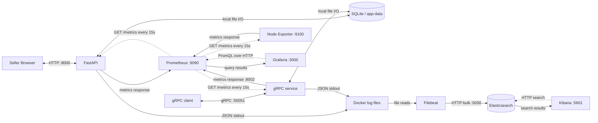

# Observable Instagram Order & Inventory Management System

## Problem, intended users and solution

Small Instagram sellers often receive orders in direct messages and track stock manually. This can cause overselling, missed orders and uncertainty about fulfilment. This local order desk lets a seller record a non-sensitive reference, reserve inventory and follow an order through packing, shipping and completion.

FastAPI handles validation and business rules; SQLite transactions store products and orders; a browser interface provides the seller workflow. The system supports products, variants, prices, stock updates, multi-item orders through the API, stock validation, cancellation and fulfilment transitions. It does not connect to Instagram, send messages, process payments or provide production authentication. Use synthetic references, not customer names, contact details or copied messages.

Read the [final requirement audit](docs/final-assignment-audit.md) and [short A–E report](docs/assignment-report.md). The report includes the current dashboard and target screenshots; saved backend results and any remaining visual limitations are identified clearly.

**Assignment 2** extends this project with an improved HTTP API (OpenAPI, idempotency, rate limiting, consistent errors), a resilient Python caller, a gRPC `CreateOrder` service, and gRPC metrics in Prometheus and Grafana. See [the Assignment 2 report](docs/assignment2-report.md), [the scope note](docs/a2-scope.md) and the [Assignment 2 section](#assignment-2-http-api-grpc-and-metrics) below.

## Architecture



Solid response arrows show data flow; dotted arrows show pull requests. [Part D](docs/part-d-system-design.md) explains responsibilities, storage, design choices, component failures and one actual metric/log journey. Node Exporter measures the **Docker Desktop Linux/WSL2 environment visible to its container**, not all native Windows activity or FastAPI-only resource usage. The HTTP and gRPC services share one business function (`place_order()` in `app/order_services.py`) and one SQLite database; the Assignment 2 report contains separate call-path diagrams for each.

## Prerequisites and installation

- Docker Desktop running in Linux-container mode; on Windows its WSL2 backend must be available.
- Docker Compose v2-compatible commands (`docker compose`) and internet access for initial downloads.
- Free ports 8000, 9090, 3000, 9200 and 5601, plus **50051 (gRPC) and 8002 (gRPC metrics)**; isolated cardinality tests also use 8010 and 9091.
- Python 3.10+ for scripts/tests. Audit environment: host Python 3.14; app container Python 3.12.
- Enough Docker memory for the stack; Elasticsearch alone has a configured 512 MiB JVM heap.

PowerShell commands below run from the project root. No virtual-environment activation is required:

```powershell
python -m venv .venv
.\.venv\Scripts\python.exe -m pip install -r requirements.txt
docker compose config --quiet
docker compose up -d --build
docker compose ps
```

`requirements.txt` includes `grpcio` and `grpcio-tools`. Wait for health checks. Filebeat and Node Exporter have no Compose health checks: verify the Filebeat output connection and Prometheus target respectively. Tables are created automatically (including the `idempotency_keys` table). This is a local HTTP teaching deployment with Elasticsearch security disabled; it is not configured for public hosting.

For application-only local execution, first stop any container using port 8000:

```powershell
.\.venv\Scripts\python.exe -m uvicorn app.main:app --host 127.0.0.1 --port 8000
```

Local execution uses `data/orders.db`. Docker uses `/app/data/orders.db` in `app-data`; these are separate databases. Use full Compose for Docker/Filebeat observability.

## Service URLs and access

| Service | URL | Use |
|---|---|---|
| Seller interface | http://localhost:8000/ | Inventory and orders |
| API documentation | http://localhost:8000/docs | Interactive endpoint reference (generated OpenAPI) |
| OpenAPI document | http://localhost:8000/openapi.json and `docs/openapi.json` | Machine-readable API contract |
| Health / metrics | http://localhost:8000/health and http://localhost:8000/metrics | Health JSON and Prometheus text |
| gRPC service | `localhost:50051` | `orders.v1.OrderService/CreateOrder` (plaintext, local only) |
| gRPC metrics | http://localhost:8002/metrics | Prometheus text for the gRPC container |
| Prometheus | http://localhost:9090/query | PromQL; target status at `/targets` (jobs `fastapi-app`, `grpc-service`, `node-exporter`) |
| Grafana | http://localhost:3000/ | **Observable Orders → Observable Instagram Orders** dashboard |
| Elasticsearch | http://localhost:9200/ | HTTP API |
| Kibana | http://localhost:5601/ | Discover log search |
| Node Exporter | `http://node-exporter:9100/metrics` inside Compose | Port not published to host |
| Cardinality exporter / Prometheus | http://localhost:8010/metrics and http://localhost:9091/query | Separate explicitly started test project |

Grafana datasource/dashboard files are provisioned from `grafana/`. A fresh volume uses initial login `admin` / `admin` and asks for a password change. An existing volume retains its password: use your existing credentials. The audit did not reset or bypass authentication. Direct dashboard: `http://localhost:3000/d/observable-orders/observable-instagram-orders`.

Kibana's current environment contains **Observable Orders Logs**, data view ID `observable-orders-v3`, pattern `observable-orders-v3-*`, time field `@timestamp`. **On a fresh volume**, generate application traffic, then use **Stack Management → Data Views → Create data view** with that pattern and time field. Compose does not automatically create the data view. Use [saved KQL queries](docs/kibana-queries.kql) in Discover.

## Use the application

1. Add a product with a name, optional variant, nonnegative price and stock.
2. Submit an order with a non-sensitive reference and positive quantity. Insufficient stock is rejected without creating an order.
3. New orders are **PENDING** and reserve inventory. Available stock is physical stock minus reservations.
4. Follow **PENDING → PACKED → SHIPPED → COMPLETED**. Packing deducts physical stock and releases reservations. Invalid skips are rejected.
5. Cancel PENDING orders to release reservations; cancelling PACKED/SHIPPED restores deducted stock. COMPLETED and CANCELLED are final.
6. Update physical stock, keeping it at least as large as current reservations. The UI's sold count is derived from PACKED, SHIPPED and COMPLETED orders.

Routes: GET/POST `/api/products`, PATCH `/api/products/{id}/stock`, GET/POST `/api/orders`, PATCH `/api/orders/{id}/status`. The API accepts multiple order items; the browser form currently selects one item per submission.

Errors use one format, `{"error": {"code": "...", "message": "..."}}`, with these statuses: `404` missing product/order, `409` conflict (insufficient stock, invalid status transition, duplicate product), `422` validation error or idempotency-key misuse, `429` rate limit exceeded.

## Assignment 2: HTTP API, gRPC and metrics

### Task and shared code

The chosen task is **place an order**: HTTP `POST /api/orders` and gRPC `OrderService.CreateOrder`. Both call `place_order()` in `app/order_services.py`, which calls `Store.create_order_idempotent()` in `app/services.py` and uses the same SQLite database. See `docs/a2-scope.md`.

### OpenAPI

FastAPI generates the specification from the route definitions. Export it after any API change (output is saved to `docs/openapi.json`):

```powershell
$env:PYTHONPATH='.'
.\.venv\Scripts\python.exe -c "import json; from app.main import app; print(json.dumps(app.openapi(), indent=2))" | Out-File -Encoding utf8 docs\openapi.json
```

Use Swagger UI at http://localhost:8000/docs (**Try it out**) to test an endpoint against the contract.

### Idempotency and rate limiting

- `POST /api/orders` accepts an optional `Idempotency-Key` header (1–128 characters). Repeating the same key and body returns the original order with header `Idempotent-Replay: true` and creates no second order or reservation. The same key with a different body returns `422 idempotency_key_reuse`. Keys are stored in the `idempotency_keys` table in the same transaction as the order.
- `POST /api/orders` is limited to **5 requests per 10-second fixed window per client IP** (single instance, in memory). Excess calls return `429` with `Retry-After`. Change the limit with the environment variables `RATE_LIMIT_MAX` and `RATE_LIMIT_WINDOW`; the default Compose file keeps 5 and 10.
- Scripts that send orders faster than 5 per 10 seconds need a higher limit. `docker-compose.experiment.yml` sets `RATE_LIMIT_MAX=1000` for the latency experiment. For `scripts/normal_traffic.py` start the app with a higher limit, then restore it:

```powershell
$env:RATE_LIMIT_MAX = "1000"
docker compose -f docker-compose.yml up -d --no-deps --force-recreate app
python scripts/normal_traffic.py --count 60 --interval 1
Remove-Item Env:RATE_LIMIT_MAX
docker compose -f docker-compose.yml up -d --no-deps --force-recreate app
```

Rate-limit demonstration (needs a product with stock and an order body in `body.json`; use `curl.exe`, not the PowerShell `curl` alias). Expect five `201` responses, then `429` with `retry-after`, then `201` after waiting:

```powershell
1..8 | ForEach-Object { curl.exe -s -i -X POST http://localhost:8000/api/orders -H "Content-Type: application/json" --data "@body.json" | Select-String "^HTTP|^retry-after" }
```

Saved results: `docs/evidence/rate-limit.txt`.

### Resilient Python caller

`scripts/resilient_caller.py` calls `POST /api/orders` with a 2.0 s timeout, up to 3 attempts with backoff (0.5 s, then 1.0 s), one reused `Idempotency-Key` per order, and a circuit breaker (opens after 3 consecutive failed calls, 6.0 s recovery period). It demonstrates success, retry, open breaker and recovery in one run:

```powershell
.\.venv\Scripts\python.exe scripts/resilient_caller.py | Tee-Object docs\evidence\caller.txt
```

The failure is simulated by pointing the failing calls at an unused local port, so the application does not need to be stopped. Rate limiting is demonstrated separately with the loop above.

### gRPC service

Contract: `proto/orders.proto` (`OrderService.CreateOrder`). Generate the Python code (output in `app/grpc_gen/`):

```powershell
New-Item -ItemType Directory -Force app\grpc_gen | Out-Null
.\.venv\Scripts\python.exe -m grpc_tools.protoc -I proto --python_out=app/grpc_gen --grpc_python_out=app/grpc_gen proto/orders.proto
```

Start and check the service (container `observable-orders-grpc`, gRPC on 50051, metrics on 8002; it shares the `app-data` volume with the app):

```powershell
docker compose up -d --build grpc-service
docker compose ps
docker compose logs --no-color --tail 20 grpc-service
```

Call it with the client (sets a 2 s deadline, sends `x-request-id` metadata, prints the result or the gRPC status). Run `--help` for the exact arguments:

```powershell
$env:PYTHONPATH='.'
.\.venv\Scripts\python.exe client/grpc_order_client.py --help
```

Status mapping: bad input → `INVALID_ARGUMENT`, missing product → `NOT_FOUND`, insufficient stock → `FAILED_PRECONDITION`, idempotency-key reuse with a different request → `INVALID_ARGUMENT`.

Repeatable calls (5 valid, 2 quantity-0, 2 over-stock, 1 unknown product) and a concurrent run (8 clients, about 90 seconds) populate the dashboard:

```powershell
$env:PYTHONPATH='.'
.\.venv\Scripts\python.exe scripts/grpc_traffic.py | Tee-Object docs\evidence\grpc_traffic.txt
.\.venv\Scripts\python.exe scripts/grpc_concurrent.py
```

Log correlation: send a known request ID (client `x-request-id` metadata) and search `request_id : "<id>"` in Kibana. Filebeat admits both `observable-orders-app` and `observable-orders-grpc` containers.

### gRPC metrics and dashboard

Prometheus scrapes `grpc-service:8002` as job `grpc-service` (`prometheus/prometheus.yml`); check http://localhost:9090/targets. Metrics (duration is measured at the server; labels are bounded):

| Metric | Type | Labels |
|---|---|---|
| `grpc_server_handled_total` | Counter | `grpc_service`, `grpc_method`, `grpc_code` |
| `grpc_server_handling_seconds` | Histogram | `grpc_service`, `grpc_method` |
| `grpc_server_in_flight_requests` | Gauge | `grpc_service`, `grpc_method` |

```promql
sum by (grpc_method, grpc_code) (rate(grpc_server_handled_total[5m]))
sum(rate(grpc_server_handled_total{grpc_code!="OK"}[5m])) / sum(rate(grpc_server_handled_total[5m]))
histogram_quantile(0.50, sum by (le) (rate(grpc_server_handling_seconds_bucket[5m])))
histogram_quantile(0.95, sum by (le) (rate(grpc_server_handling_seconds_bucket[5m])))
sum by (grpc_method) (grpc_server_in_flight_requests)
```

The Grafana dashboard shows the gRPC panels beside the HTTP `POST /api/orders` panels (provisioned from `grafana/`). Use the last 15 minutes and a 5-minute rate after running the traffic scripts, and wait one or two scrapes (15 s each). Screenshots: `docs/screenshots/`.

### Assignment 2 tests

```powershell
.\.venv\Scripts\python.exe -m pytest -q
```

`tests/test_api_a2.py` covers a valid order, invalid input, repeated idempotency key, key reuse with a different body, and `429` with `Retry-After`. `tests/test_grpc.py` starts an in-process gRPC server and asserts `OK` and the error codes. Pass `rate_limit=1000` to `create_app` in tests that create many orders.

## Normal traffic, Prometheus and Grafana

```powershell
Set-Content experiments/control/latency.txt DISABLED
docker compose -f docker-compose.yml up -d --no-deps app
docker compose exec -T app python -c "from app.experiment_fault import OrderLatencyFault; print('fault armed:', OrderLatencyFault().armed)"
python scripts/normal_traffic.py --count 60 --interval 1
```

The normal runner creates its own labelled fixture, sends 60 accepted orders, alternates completion/cancellation, and deliberately makes six insufficient-stock attempts. It runs for over a minute, allowing several 15-second scrapes, then restocks only its fixture. Completed/cancelled test records remain. Results go to `docs/audit-evidence/normal-<UTC timestamp>/`. It never activates a fault. Because it exceeds the default order rate limit, start the app with `RATE_LIMIT_MAX=1000` first (see the Assignment 2 section).

In Prometheus check `up{job="fastapi-app"}`, `up{job="grpc-service"}` and `up{job="node-exporter"}` equal 1. Try:

```promql
orders_created_total
pending_orders
sum by (route) (rate(http_requests_total[5m]))
histogram_quantile(0.95, sum by (le) (rate(http_request_duration_seconds_bucket[5m])))
sum by (terminal_status) (rate(order_processing_seconds_sum[5m])) / sum by (terminal_status) (rate(order_processing_seconds_count[5m]))
```

Run these as separate expressions. [The metric catalog](docs/metrics-catalog.md) gives every custom metric's purpose, type, unit, labels, recording code, Grafana expression and chart interpretation. The dashboard includes Counter, Gauge, Histogram and **Order lifecycle average (Summary)** panels. Python Summary supplies sum/count rather than quantiles; the Histogram supplies p95. Grafana's `$__rate_interval` depends on range/resolution; inspect its expanded query for the exact window. Choose a historical absolute range for saved experiments, not today's “Last 15 minutes”.

## Logs and Kibana

The application emits JSON with timestamp, object-shaped `service.name`, severity, message and request ID, plus relevant IDs, transitions and durations. It does not intentionally log request bodies, customer references, product names, secrets or full exception messages. Do not put personal data in `X-Request-ID` (HTTP) or `x-request-id` (gRPC metadata).

Filebeat unwraps Docker logs, attaches metadata, filters on the application containers (`observable-orders-app` and `observable-orders-grpc`), decodes into temporary `json`, copies searchable fields and drops that temporary object. Uvicorn access lines from the same container are also admitted and can have JSON-decoding-error fields. The existing `message` remains JSON text: the current copy processor does not replace it. Application `timestamp` stays inside that text; top-level `@timestamp` is Docker capture time.

```powershell
docker compose logs --no-color --tail 50 app
docker compose logs --no-color --tail 50 grpc-service
docker compose logs --no-color --tail 50 filebeat
docker compose exec -T filebeat filebeat test config --strict.perms=false
docker compose exec -T filebeat filebeat test output --strict.perms=false
```

Select **Observable Orders Logs** in Discover and enter one query at a time:

```kql
request_id : "pipeline-proof-20260922171843"
order_id : 20
severity : "WARNING" and message : "order rejected"
severity : "ERROR"
service.name : "instagram-order-desk"
```

The saved proof occurred **2026-09-22 12:18:43 UTC / 17:18:43 Asia/Karachi**. For fresh traffic use its saved request prefix. `request_id` is a keyword already; do not append `.keyword`. Historical indexing failures were caused by scalar `service` conflicting with its object mapping; the current formatter emits `service: {name: ...}`. Do not create another pipeline version to work around an unexplained error.

## Storage, retention and restarts

| Data | Persistent location | Behavior |
|---|---|---|
| Orders/products/idempotency keys | `app-data:/app/data` (shared by `app` and `grpc-service`) | Survives container replacement; volume deletion removes it |
| Metric history | `prometheus-data:/prometheus` | Survives replacement; main Compose does not override Prometheus's default retention |
| Grafana settings | `grafana-data:/var/lib/grafana` | Datasource/dashboard also provisioned from files |
| Indexed logs and Kibana saved objects | `elasticsearch-data:/usr/share/elasticsearch/data` | No age-deletion policy observed for v3; indexed logs stay until deleted or storage is removed |
| Filebeat offsets | `filebeat-data-v3:/usr/share/filebeat/data` | Remembers harvesting position; not a log archive |
| Kibana local runtime data | `kibana-data:/usr/share/kibana/data` | Data views/dashboard saved objects primarily live in Elasticsearch |
| Docker raw logs | Engine `/var/lib/docker/containers` | Same-container restart preserves files; removal/recreation can remove them. Audit found `json-file` with no rotation options |

Named volumes are inside Docker's Linux storage, outside this source folder; names normally have project prefix `assig1_`. No automatic Docker size/age rotation is configured for the inspected app container. No v3 Elasticsearch ILM or data-stream retention policy was observed. Therefore there is no configured age at which indexed application logs are automatically deleted. Filebeat retries transient output failures, but permanent mapping errors can drop events. Its registry cannot recover removed source files. Indexed copies are independent of raw Docker logs. Persistence is not a backup or high-availability guarantee.

## Latency experiment

[Part E](docs/part-e-controlled-problem.md) contains the actual normal/fault/recovery results, immutable prediction file, time ranges, PromQL and KQL. The fault needs explicit experiment startup configuration AND a fresh local token, and expires after five minutes. Ordinary Compose does not enable it. The experiment Compose file also raises the order rate limit (`RATE_LIMIT_MAX=1000`) so the unchanged workload is not rate limited.

Use a new run name, keep the workload unchanged and freeze predictions before the fault:

```powershell
Set-Content experiments/control/latency.txt DISABLED
docker compose -f docker-compose.yml -f docker-compose.experiment.yml up -d --build app
python scripts/part_e_workload.py --phase normal --run my-new-run --ack-test-data
# NOW write experiments/results/my-new-run/predictions.md from baseline results.
python scripts/part_e_workload.py --phase fault --run my-new-run --ack-test-data
# Record comparison/analysis before recovery.
python scripts/part_e_workload.py --phase recovery --run my-new-run --ack-test-data
.\.venv\Scripts\python.exe scripts/part_e_report.py my-new-run
python scripts/part_e_verify.py my-new-run
Set-Content experiments/control/latency.txt DISABLED
docker compose -f docker-compose.yml up -d --no-deps --force-recreate app
```

No unrelated order traffic should run during measurement. Do not restart the app between measured phases. The runner disables the token in `finally` and cancels its own test orders; final recreation removes the startup opt-in only after recovery evidence is saved.

## Cardinality experiment

This uses its own exporter, registry, network and Prometheus. Exactly 100 distinct IDs are sent per version. Only the exporter restarts between versions, preserving test history. [The report](docs/cardinality-experiment.md) records **100 → 1** series, historical evidence and screenshot steps.

```powershell
$env:CARDINALITY_MODE='request-id'
docker compose -p cardinality-demo -f experiments/cardinality/compose.yml up -d --build --force-recreate exporter
docker compose -p cardinality-demo -f experiments/cardinality/compose.yml up -d prometheus
python experiments/cardinality/run.py --mode request-id --run my-cardinality-run
$env:CARDINALITY_MODE='no-label'
docker compose -p cardinality-demo -f experiments/cardinality/compose.yml up -d --no-deps --force-recreate exporter
python experiments/cardinality/run.py --mode no-label --run my-cardinality-run
python experiments/cardinality/verify.py my-cardinality-run
Remove-Item Env:CARDINALITY_MODE
```

Use `count(demo_requests_total)` in **test Prometheus on 9091** after a successful scrape. `sum(demo_requests_total)` is 100 in both versions. Do not increase the cap or attempt a crash. Removing labels does not erase stored historical samples.

## Tests and configuration checks

```powershell
.\.venv\Scripts\python.exe -m pytest -q
.\.venv\Scripts\python.exe -m pip check
docker compose run --rm --no-deps --volume ./tests:/app/tests:ro app python -m pytest -q -p no:cacheprovider
docker compose config --quiet
docker compose -f docker-compose.yml -f docker-compose.experiment.yml config --quiet
docker compose -p cardinality-demo -f experiments/cardinality/compose.yml config --quiet
docker compose exec -T prometheus promtool check config /etc/prometheus/prometheus.yml
docker compose exec -T filebeat filebeat test config --strict.perms=false
docker compose exec -T filebeat filebeat test output --strict.perms=false
python experiments/cardinality/verify.py cardinality-20260923
```

If `pytest` reports `ModuleNotFoundError: app`, run it as `python -m pytest -q` or set `$env:PYTHONPATH='.'` first. If Node is installed, run `node tests/test_ui.cjs`. The audit executed the same JavaScript regression using Kibana's bundled Node, without installing packages. It checks generated markup, not a rendered browser. After normal traffic, `python scripts/audit_observability.py` captures service health, all dashboard queries with a 5-minute window and actual Elasticsearch searches. A protected Grafana API returning 401 is recorded as such, not bypassed.

## Stop and safely clean up

```powershell
Set-Content experiments/control/latency.txt DISABLED
docker compose stop
docker compose -p cardinality-demo -f experiments/cardinality/compose.yml stop
```

`stop` preserves containers/volumes (including `grpc-service`). `start` restarts existing containers with their existing environment; recreate the app with the base Compose file if an experiment configuration (or a raised `RATE_LIMIT_MAX`) may remain. `docker compose down` removes containers/network and keeps named volumes, but raw container logs may disappear. The separate project's equivalent uses `-p cardinality-demo -f experiments/cardinality/compose.yml down`.

For an intentional complete reset **only after saving evidence/backups**, adding `-v` to the appropriate `down` command deletes that project's declared volumes. This destroys orders and monitoring history and is **not necessary for submission cleanup**. Never use global Docker prune to prepare this assignment. Removing local `data/orders.db` affects only the non-Docker database.

## Safe submission packaging

Do not zip the entire workspace. Downloaded `.venv` packages and runtime databases are present; `.gitignore` does not filter normal ZIP tools. This workspace has no `.git` metadata, so tracked-file checks are unavailable.

```powershell
Set-Content experiments/control/latency.txt DISABLED
python scripts/package_submission.py
```

Submit `submission/assignment1.zip` (the packager's output name), not the parent directory. The packager uses explicit source/evidence roots and file types (including `proto/`, `client/`, `grpc_server/`, `app/grpc_gen/`, the OpenAPI document, Prometheus and Grafana configuration, tests and the Assignment 2 docs), excludes dependency trees, caches, databases, secrets files, archives and volume dumps, and reopens the ZIP to validate exclusions and integrity. `submission/manifest.json` records included paths, sizes and SHA-256 values. Raw JSON/text experiment evidence is intentionally included; downloaded packages and Docker volumes are not. No working data is deleted.

Add screenshots under `docs/screenshots/`, review [credits and assistance disclosure](docs/credits.md), and regenerate the ZIP after updates. The reports use Markdown/Mermaid; view them in a renderer supporting Mermaid or export to the instructor's required format. Submission channel/deadline and identification requirements were not supplied in the original specification.

## Troubleshooting

| Problem | Check/action |
|---|---|
| Docker engine pipe missing | Start Docker Desktop, verify Linux/WSL2 mode, run `docker compose ps` |
| Port in use | Stop the duplicate process/container; do not run two apps on 8000, or two gRPC services on 50051 |
| Elastic services starting | Inspect `docker compose logs --tail 50 elasticsearch kibana`; allow startup time and enough memory |
| Grafana login fails | Use credentials retained in `grafana-data`; defaults apply only to a fresh volume |
| Empty rate/Summary panel | Generate traffic and terminal events, wait multiple scrapes and select the right time range. No terminal events means the average is undefined |
| Summary panel missing | Confirm dashboard JSON has panel 14; wait for provisioning or restart Grafana |
| Disk chart empty on another host | Inspect `node_filesystem_size_bytes` labels. The supplied panel uses the verified Docker Desktop ext4 mount `/mnt/docker-desktop-disk`, not a universal path |
| No Kibana data view | Create `observable-orders-v3-*` with `@timestamp` after traffic |
| Historical event missing | Use its exact date/time range and `request_id`, not `request_id.keyword` |
| Docker logs but no ES document | Validate Filebeat output and indexing errors; check `container.name` filtering and object-shaped `service` |
| gRPC request ID not found in Kibana | Confirm Filebeat's filter includes `observable-orders-grpc`, check `docker compose logs grpc-service` for JSON lines, and search the exact time range |
| Uvicorn JSON parse error | Access lines are plain text; structured app events are separate JSON lines |
| Unexpected fault latency | Write DISABLED and recreate app with base Compose; verify `OrderLatencyFault().armed` is false |
| Cardinality metric absent on 9090 | Query isolated Prometheus on 9091 after its scrape |
| Experiment directory exists | Use a new run name; preserve old evidence/predictions |
| Pytest temporary-directory denial | Use a fresh writable `--basetemp` directory or grant the test process temp access |
| `429 Too Many Requests` from a script | The order endpoint allows 5 requests per 10 s per IP. Wait for `Retry-After`, or start the app with a higher `RATE_LIMIT_MAX` for the run, then restore it |
| Order API returns `422` for a repeated key | The same `Idempotency-Key` was used earlier with a different body; use a new key or resend the original body |
| `ModuleNotFoundError: orders_pb2` | Regenerate the gRPC code with the command above and keep `app/grpc_gen/__init__.py` |
| gRPC panels empty | Check `up{job="grpc-service"}` on Prometheus, run `scripts/grpc_traffic.py`, wait one or two scrapes, and use the last 15 minutes. The in-flight gauge reads 0 unless calls overlap, so use `scripts/grpc_concurrent.py` |
| gRPC client times out | Check `docker compose ps` shows `grpc-service` running and port 50051 free; the client deadline is 2 s |

Audit warnings include two host dependency deprecations and a bundled Grafana `table` plugin duplicate-registration message. Health and dashboard provisioning succeeded; rendered UI behavior still needs the manual check in the audit. These warnings are not falsely reported as either test failures or proof of UI success.