# Assignment 3: Load Balancing and Observability

Instagram order desk (A1/A2) behind Envoy, with three replicas A, B and C. Every number below comes from a file
in `results/`: the client output (`<run>.json`), raw Prometheus responses (`<run>.prometheus.json`), raw
Elasticsearch responses (`<run>.es.json`, `<run>.es-timerange.json`), the per-run comparison
(`<run>.summary.json`) and the failure timelines (`d3-fail-*.events.json`, `d3-fail-*.envoy-hc.log`).
`results/summary-table.md` is generated by `scripts/summarize_results.py`. All runs took place on 2026-11-14
between 13:50 and 14:13 UTC, which is 18:50 to 19:13 Karachi time (PKT, UTC+5). Grafana and Kibana display PKT,
so the screenshot captions use PKT.

| Stage | HTTP run (PKT) | gRPC run (PKT) | Source |
|---|---|---|---|
| 1 Baseline, A only | 18:50:36 – 18:51:36 | 18:52:22 – 18:53:22 | `b-aonly-*.json` |
| 2 Round robin | 18:54:12 – 18:55:12 | 18:55:58 – 18:56:58 | `c-rr-*.json` |
| 3 Weighted 2:1:1 | 18:57:50 – 18:58:50 | 18:59:35 – 19:00:35 | `d1-weighted-*.json` |
| 4 RR, B +200 ms | 19:01:32 – 19:02:32 | 19:03:18 – 19:04:18 | `d2-rr-delayB-*.json` |
| 5 Least request, B +200 ms | 19:05:09 – 19:06:09 | 19:06:52 – 19:07:52 | `d2-least-delayB-*.json` |
| 6 Failure and recovery (90 s) | 19:08:49 – 19:10:19 | 19:11:12 – 19:12:42 | `d3-fail-*.json` |

## 1. Architecture and shared state

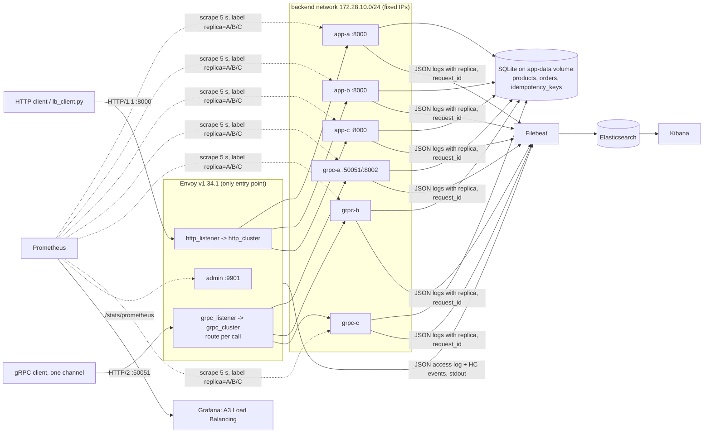

A replica is one HTTP container plus one gRPC container (`app-x`, `grpc-x`). All six run from the same image
and the same Compose definition (YAML anchors `x-app-replica` and `x-grpc-replica`). I used three named services
instead of `--scale`, because `--scale` gives anonymous copies behind one DNS name: there would be no stable
A/B/C identity for Envoy endpoints, no "A only" cluster, no per-replica Prometheus targets and no way to inject
a fault into one replica. The replicas publish no host ports, so clients can only reach them through Envoy.
Prometheus reaches them directly on the backend network.

**Identity and correlation.** Each Prometheus target has a static `replica` label, so no metric needs an
in-code label and no unique ID ever becomes a label. In the logs, each replica sets `REPLICA_ID`, the JSON
formatter writes `replica`, and Filebeat also adds `replica` from the container name. Envoy uses
`preserve_external_request_id`, so it keeps the client's `x-request-id` and forwards it. The application
already logs it as `request_id`. Envoy's access log writes the same ID as `request_id` and `trace_id`, and
writes the selected replica from endpoint metadata (`%UPSTREAM_METADATA(replica_info:replica)%`).

| State | Where it lives | Shared by all replicas? | Effect of spreading requests |
|---|---|---|---|
| Products, orders, stock reservations | SQLite file on the `app-data` volume, written in `BEGIN IMMEDIATE` transactions | **Shared** | None: every replica sees the same stock, so business rules hold |
| Idempotency records (`idempotency_keys`) | Same SQLite database, same transaction as the order | **Shared** | Safe. In `c-rr-grpc`, call 1 created order 682 on **B**, then call 2 replayed it on **C** and call 3 on **A**. Each gRPC run created exactly 1 order and replayed the rest (for example 1 created, 1199 replayed) |
| HTTP rate-limit counters (5 POST `/api/orders` per 10 s per client IP) | Python dict in each process | **Per replica** (in memory) | With round robin, one client's requests are split over 3 independent counters, so the effective limit is about 3x (15 per 10 s). A client can be blocked on one replica and allowed on the next. Also, behind Envoy the app sees Envoy's IP as `request.client.host`, so all clients share one counter per replica. Fix: a shared store (for example Redis) keyed on the real client IP from `X-Forwarded-For` (trusted proxy) |
| Prometheus counters, gauges and histograms | Each process | **Per replica** | Intended: queries `sum by (replica)` and totals across replicas. A restart resets that replica's counters (seen in the failure run) |

Known limit: SQLite on one shared volume works for 6 local containers, but it is a single-host design. Its write
lock serialises the `BEGIN IMMEDIATE` replays. Real horizontal scaling would need a networked database.

## 2. Envoy configuration and health-check settings

`scripts/make_envoy_config.py <a-only|rr|weighted|least> [--health]` generates `envoy/envoy.yaml`. Every
variant passes `envoy --mode validate`. Each interface has one `STRICT_DNS` cluster (`http_cluster`,
`grpc_cluster`). The gRPC listener is an HTTP connection manager with `codec_type: HTTP2`, and the gRPC cluster
uses HTTP/2 upstream (`explicit_http_config.http2_protocol_options`), so Envoy routes **each call**, not each
connection. Envoy retries, circuit-breaker tuning and client retries are all off. The client timeout is 5 s.

| Setting | HTTP cluster | gRPC cluster |
|---|---|---|
| Check | `GET /health` on :8000 | HTTP/1 (`codec_client_type: HTTP1`) `GET /metrics` on :8002 (`health_check_config.port_value`) |
| interval / timeout | 2 s / 1 s | 2 s / 1 s |
| unhealthy_threshold / healthy_threshold | 3 / 2 | 3 / 2 |
| no_traffic_interval | 2 s | 2 s |
| connect_timeout | 1 s | 1 s |
| DNS | `dns_refresh_rate` 300 s, `dns_failure_refresh_rate` 1-5 s | same |

The long DNS refresh and the fixed replica IPs make the **health checker**, not Docker DNS, decide removal and
recovery. Without them, a stopped container's name stops resolving, and a restarted container can get a new IP.
Envoy is restarted before each failure run, so the 300 s timer cannot fire during it. Caveats:
`dns_refresh_rate` is deprecated in 1.34 (it still works), and a 300 s refresh would be too slow in a real
deployment where IPs change.

## 3. Metrics and queries

Workload: `scripts/lb_client.py` is open loop. Sends are scheduled at t0 + n/20 s and never wait for earlier
responses. The rate is **20 req/s for 60 s (1200 requests)** per interface, or 90 s for the failure runs.
HTTP = `GET /api/products`. gRPC = `CreateOrder` with one fixed idempotency key per run, so these are replays.
Client percentiles use nearest rank over all requests.

Dashboard `a3-load-balancing` (export: `docs/a3/dashboard.json`) uses a fixed `[1m]` window everywhere.
`$C` = `http_requests_total{job="fastapi-app",route="/api/products"}`, or for gRPC
`grpc_server_handled_total{job="grpc-service",grpc_method="CreateOrder"}`.

| Panel | PromQL |
|---|---|
| Request rate | `sum by (replica) (rate($C[1m]))` |
| Share % | `100 * sum by (replica) (rate($C[1m])) / ignoring(replica) group_left sum(rate($C[1m]))` |
| Active requests | `max by (replica) (http_server_active_requests)` / `grpc_server_in_flight_requests{grpc_method="CreateOrder"}` (gauge, sampled every 5 s), plus `sum by (replica) (rate(<duration>_sum[1m]))` = average in-flight (Little's law) |
| p50 / p95 (server histogram, **1-minute window**) | `histogram_quantile(0.95, sum by (replica, le) (rate(<duration>_bucket{...}[1m])))` |
| Errors by status | `sum by (replica, status_code) (rate(http_requests_total{route="/api/products",status_code!~"2.."}[1m]))`, gRPC `grpc_code!="OK"` |
| Envoy | `rate(envoy_cluster_upstream_rq_total[1m])`, `envoy_cluster_membership_healthy/total`, `envoy_cluster_upstream_rq_active`, `rate(envoy_cluster_upstream_rq_xx{envoy_response_code_class="5"}[1m])`, `rate(envoy_cluster_upstream_cx_connect_fail[1m])` |

Prometheus scrapes A, B, C (HTTP :8000 and gRPC :8002 for each) and Envoy's admin port (:9901) **directly** on the
backend network, every 5 s, never through the balanced route. Client percentiles (results table) cover the whole
run. Server p50/p95 in `results/summary-table.md` use `increase(bucket[run window])`, which is the exact run
window. Dashboard panels use a sliding 1-minute window, so each point on a chart covers the 60 s before it.

`http_server_active_requests` is new. It comes from a pure ASGI middleware (`app/active_requests.py`) that
excludes `/health` and `/metrics`. The same middleware applies the delay from `experiments/lb/delay-<x>.txt`.
The gRPC server reads the same file. For the results table, `scripts/collect_run.py` takes the exact counter
increase per replica over each run window (range query, step 5 s, counter-reset aware), server p50/p95 from
`increase(bucket[run window])`, and counts the Envoy access-log events per replica in Elasticsearch.

## 4. Results

| Run / interface | Policy and fault | Target / actual rps | A/B/C share % (Prometheus) | Client p95 ms | Error rate | Explanation |
|---|---|---|---|---|---|---|
| b-aonly-http | A only | 20 / 20.000 | 100.0 / 0.0 / 0.0 | 27.49 | 0% (0/1200) | Baseline: B and C running but idle |
| b-aonly-grpc | A only | 20 / 19.999 | 100.0 / 0.0 / 0.0 | 17.04 | 0% (0/1200) | Baseline |
| c-rr-http | RR 1:1:1 | 20 / 19.999 | 33.3 / 33.3 / 33.3 | 20.89 | 0% | Exactly 400/400/400 |
| c-rr-grpc | RR 1:1:1, HTTP/2 per call | 20 / 20.000 | 33.3 / 33.3 / 33.3 | 13.06 | 0% | One client connection, calls still spread 400/400/400 |
| d1-weighted-http | Weighted 2:1:1 | 20 / 19.999 | 50.0 / 24.9 / 25.1 | 22.20 | 0% | 600/299/301 |
| d1-weighted-grpc | Weighted 2:1:1 | 20 / 20.003 | 50.0 / 25.0 / 25.0 | 11.59 | 0% | 600/300/300 |
| d2-rr-delayB-http | RR; B +200 ms | 20 / 20.002 | 33.4 / 33.3 / 33.2 | 220.52 | 0% | RR ignores B's slowness; 33.3% of requests > 200 ms |
| d2-rr-delayB-grpc | RR; B +200 ms | 20 / 19.996 | 33.3 / 33.3 / 33.3 | 210.48 | 0% | Same |
| d2-least-delayB-http | Least request (choice 3); B +200 ms | 20 / 19.998 | 42.5 / 16.0 / 41.5 | 218.77 | 0% | B's share halves; p95 still above 5% of requests that hit B |
| d2-least-delayB-grpc | Least request; B +200 ms | 20 / 19.998 | 42.0 / 15.8 / 42.2 | 209.84 | 0% | Same |
| d3-fail-http | RR + health checks; B stopped at ~30 s, started at ~60 s (90 s run) | 20 / 20.000 | 40.1 / 19.9 / 40.0 | 28.30 | 2.83% (51/1800, HTTP 503 `UF`) | B removed 7.30 s after `stop`, back 3.93 s after `start` |
| d3-fail-grpc | Same | 20 / 20.002 | 39.7 / 20.8 / 39.6 | 19.23 | 2.83% (51/1800, `UNAVAILABLE`) | B removed 7.35 s after `stop`, back 5.06 s after `start` |

Additional columns (server p95 and average in-flight per replica, and Envoy-log shares) are in
`results/summary-table.md`.

**Check against Envoy's access logs (same time range).** `results/c-rr-http.es-timerange.json` counts Envoy
events with `service.name: envoy and envoy_interface: http` between the run start and run end + 15 s, without
filtering by request ID. The result is 1200 events: A 400, B 400, C 400 (33.33% each). That is identical to
Prometheus (400/400/400) and to the client's `x-served-by` counts. `d2-least-delayB-grpc.es-timerange.json`
also agrees: Envoy logs 504/189/507 = 42.0/15.75/42.25%, the same as Prometheus and the client.
The +15 s margin is needed because Envoy's stdout logger flushes in batches: the last 78 lines of `c-rr-http`
reached Docker about 6 s after the run ended, and `@timestamp` is Docker's capture time.

### Log examples (proxy + backend, same request ID)

Raw responses: `docs/a3/log-example-http.json` and `docs/a3/log-example-grpc.json` (index `observable-orders-v3-*`).
Kibana screenshots: Figure 14 (HTTP). The gRPC Kibana screenshot is **NOT COLLECTED**.

HTTP. Kibana KQL `request_id : "lb-c-rr-http-135412-2"` returns 2 events:
```json
{"service":{"name":"envoy"},"interface":"http","method":"GET","path":"/api/products","replica":"B","request_id":"lb-c-rr-http-135412-2","trace_id":"lb-c-rr-http-135412-2","response_code":200,"response_flags":"-","duration_ms":6,"upstream_host":"172.28.10.12:8000","upstream_cluster":"http_cluster","timestamp":"2026-11-14T13:54:13.082Z"}
{"service":{"name":"instagram-order-desk"},"replica":"B","request_id":"lb-c-rr-http-135412-2","message":"request completed","method":"GET","path":"/api/products","status_code":200,"duration_ms":4.42,"timestamp":"2026-11-14T13:54:13.087480+00:00"}
```
gRPC. KQL `request_id : "lb-c-rr-grpc-135558-2"` returns the Envoy event plus 3 events from `grpc-c`:
```json
{"service":{"name":"envoy"},"interface":"grpc","method":"POST","path":"/orders.v1.OrderService/CreateOrder","replica":"C","request_id":"lb-c-rr-grpc-135558-2","trace_id":"lb-c-rr-grpc-135558-2","response_code":200,"grpc_status":"OK","duration_ms":28,"upstream_host":"172.28.10.23:50051","upstream_cluster":"grpc_cluster"}
{"service":{"name":"instagram-order-desk"},"replica":"C","request_id":"lb-c-rr-grpc-135558-2","message":"gRPC CreateOrder request received"}
{"service":{"name":"instagram-order-desk"},"replica":"C","request_id":"lb-c-rr-grpc-135558-2","message":"order replayed","order_id":682}
{"service":{"name":"instagram-order-desk"},"replica":"C","request_id":"lb-c-rr-grpc-135558-2","message":"gRPC CreateOrder completed successfully","order_id":682}
```

## 5. Experiments: prediction, observation, explanation

**Baseline (A only, Parts A/B).** *Prediction:* A 100%, B and C idle. *Observed:* 1200/1200 requests on A for
both interfaces (Prometheus, Envoy logs and client all agree). The share query returned A = 100 and B = C = 0.
There were no errors. Client p95 was 27.5 ms (HTTP) and 17.0 ms (gRPC). Average in-flight on A was 0.17 (HTTP)
and 0.13 (gRPC). *Explanation:* B and C are not in Envoy's endpoint list, so they only receive Prometheus scrapes.

**Round robin (Part C).** *Prediction:* about 33% each. *Observed:* exactly 400/400/400 for both interfaces
(33.3% each, a difference of 0.0 points from 33%). *Compared with the baseline:* each replica now handles
6.7 req/s instead of A handling 20. A's average in-flight fell from 0.17 to 0.05 (HTTP). Client p95 was 20.9 ms
(HTTP, from 27.5) and 13.1 ms (gRPC, from 17.0). At 20 req/s no replica is near saturation, so the latency
change is small. Part of the difference may come from the baseline being the first runs after a restart. RR is
perfectly even because Envoy deals requests in a strict cycle and every request is identical. **gRPC:** the
client used one channel, so one HTTP/2 connection to Envoy, yet the calls spread 400/400/400. That is because
Envoy's HTTP/2 listener sees each call as a separate stream and makes a routing decision per call. With a TCP
proxy (`tcp_proxy` filter), Envoy would only see one TCP connection. It would pick one replica when the
connection opens and send all 1200 calls there (100/0/0, like the baseline but on a random replica), leaving
the other two idle. I did not run that variant.

**Weighted RR 2:1:1.** *Prediction:* 50/25/25. Latency should stay about the same, and A's active requests
should double. *Observed:* HTTP 600/299/301 (50.0/24.9/25.1) and gRPC 600/300/300. Average in-flight was
HTTP 0.07/0.03/0.04 and gRPC 0.06/0.03/0.03. Server p95 was HTTP 14.6/13.3/12.6 ms and gRPC
9.7/9.7/9.6 ms, and client p95 was 22.2 ms and 11.6 ms. *Explanation:* A gets 10 req/s, so by Little's law
(in-flight = rate x time in system) its in-flight count doubles while each request takes the same time. A's HTTP
p95 is only about 1-2 ms higher. A higher weight **does not add capacity**: it only sends more work to A. If A
were already the bottleneck, weighting it up would make the tail worse. Weights make sense only when a replica
really is bigger.

**Least request vs round robin with B delayed 200 ms** (`delay-b.txt = 200`, recorded in
`results/d2-*.delays.json`; same workload). *Prediction:* RR keeps B at 33%. Least request should move traffic
away from B, but not to 0, because at this load most decisions are ties. *Observed:* RR gave 33.3% to B, and
average in-flight on B was 1.38 (HTTP) and 1.37 (gRPC), while A and C were near 0.04. Client p95 was 220.5 ms
and 210.5 ms. 33.3% of requests took over 200 ms, and the client mean was 83.8 ms (HTTP). Least request gave
B 16.0% (HTTP) and 15.8% (gRPC), and B's average in-flight halved to 0.67 and 0.65. The client mean fell to
49.6 ms (HTTP) and 41.0 ms (gRPC), and only 16.0% of requests took over 200 ms. **Client p95 barely moved**
(218.8 and 209.8 ms). B's server p95 stayed at about 243 ms in every run. *Explanation:* least request picks the
host with the fewest outstanding requests among 3 random choices. B holds each request for over 200 ms, so it
usually has 1 or more active and loses the comparison. A and C finish in about 10 ms and are almost always at 0.
B still wins when it happens to be idle, or when all 3 random choices land on B. p95 does not improve because
16% of requests still hit B, which is more than 5%. p95 would only fall if B's share dropped below 5%. The
improvement is in the mean and in how many users wait. Note that the slow replica **passed every health check**
during these runs, because `/health` and `/metrics` are not delayed. Active health checks only detect "down",
not "slow".

**Failure and recovery** (RR, no delay, health checks on; `docker compose stop app-b grpc-b` at about 30 s,
`start` at about 60 s of a 90 s run). *Prediction:* removal after 3 failed checks, each taking a 1 s timeout
plus a 2 s interval, so about 6-9 s. During that time about 1/3 of 20 req/s fails (about 45-60 errors). Then
50/50 on A and C. Recovery after B starts (about 1-2 s) plus 2 passing checks 2 s apart, so about 3-6 s.
*Observed, from Envoy `/clusters` polled every 0.5 s (`d3-fail-*.events.json`):*

| Interface | `stop` returned | B marked unhealthy | Removal | `start` returned | B healthy | Recovery | Client errors |
|---|---|---|---|---|---|---|---|
| HTTP | 14:09:19.841 | 14:09:27.144 | **7.30 s** | 14:09:50.320 | 14:09:54.251 | **3.93 s** | 51 x 503 (`UF`), 2.83% |
| gRPC | 14:11:42.398 | 14:11:49.745 | **7.35 s** | 14:12:12.757 | 14:12:17.816 | **5.06 s** | 51 x `UNAVAILABLE` (`UF`), 2.83% |

The health flag was `active_hc_timeout,failed_active_health_check`. Envoy's health-check event log
(`d3-fail-*.envoy-hc.log`) shows the matching `eject_unhealthy_event` and `add_healthy_event`. Prometheus's
`envoy_cluster_membership_healthy` went 3 → 2 → 3 (HTTP: 14:09:29 and 14:09:59; gRPC: 14:11:57 and 14:12:22),
which is coarser because of the 5 s scrape. Client timeline (`timeline_per_second`): errors only in seconds
29-37. B received 0 requests from second 38 until normal RR traffic resumed at second 64 (HTTP) or 65 (gRPC).
*Explanation:* the stopped container no longer answers, so every check waits for the 1 s timeout. Three in a
row (2 s apart) cost about 7 s, matching the prediction. In that window RR still sent every third request to B,
and each failed with a connection failure (up to the 1 s connect timeout, client max 1015 ms). 7.3 s x 6.7 req/s
≈ 49, and 51 errors were measured. Client p95 stayed low (28.3 and 19.2 ms) because only 2.8% of requests
failed or were slow. Recovery takes the time for the app to start plus 2 healthy checks. **Counting differences
in this run:** the Envoy logs credit B with 419 (HTTP), which is 368 served (B's own log events) + 51 `UF`.
Prometheus credits B with 342, because B's in-memory counters reset on restart and lost the requests served
after the last scrape before the stop. For gRPC, B = 363 served + 51 `UF` = 414 in the Envoy logs.
Faster removal would need a shorter interval/timeout, `unhealthy_threshold` 1-2, or passive outlier detection
(eject after N consecutive 5xx/connection failures). Envoy retries to another host would hide most of these
errors, but retries were disabled for this test.

## 6. Dashboard and log screenshots

All images are in `docs/a3/screenshots/` and come from the `a3-load-balancing` dashboard or Kibana Discover.
Times are Karachi time (PKT, UTC+5) on 2026-11-14. The numbers in the captions come from `results/`, not from
reading values off the charts.

How to read the charts:

- **(a) The 1-minute window lags.** Every rate, share, latency and in-flight panel uses `[1m]`, so each point
  covers the previous 60 s. The left edge of a stage's chart still includes the stage before it, and a line keeps
  going for up to 1 minute after its traffic stops. Only points at least 60 s into a run show that run alone.
  For exact per-run numbers, use the results table, which counts over the exact run window.
- **(b) The "share now" bars show one instant.** The bar-gauge panels show only the value at the **right edge**
  of the selected time range. HTTP always ran before gRPC in each stage. By the end of the range, HTTP's 1-minute
  rate is 0 for every replica, so the share is 0/0 and the **HTTP bars are empty**. Only the gRPC bars have
  values, and those are 1-minute rates at that moment, not the run totals.
- **(c) In the failure stage, the 503s come from Envoy.** The client errors (HTTP 503 and gRPC `UNAVAILABLE`,
  response flag `UF`) were generated by Envoy when it could not connect to the stopped B. B was down, so it
  recorded nothing, and A and C served only 200/OK (`d3-fail-*.summary.json`: A 691 x 200, C 690 x 200 for HTTP;
  A 694 OK, C 692 OK for gRPC). The errors therefore appear **only in the Envoy "upstream 5xx and connect
  failures" panel**. The per-replica "errors by status" panels stay empty.

### Stage 1: baseline, A only (HTTP 18:50:36–18:51:36, gRPC 18:52:22–18:53:22)

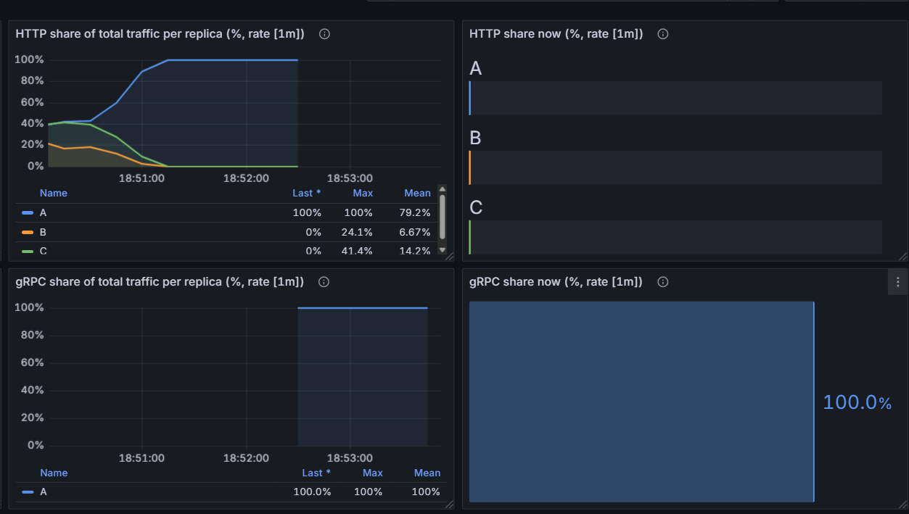
*Figure 1. Stage 1 baseline, share panels, chart axis about 18:50:30–18:53:40 PKT.* HTTP's share rises to 100% for
A only as the 1-minute window fills. B and C appear at the left edge **(a)**: that is traffic from before the
baseline, still inside the window. The HTTP "share now" bars are empty **(b)**. gRPC is 100% A for the whole run.
Results: 1200/1200 on A for both interfaces, 0 errors.

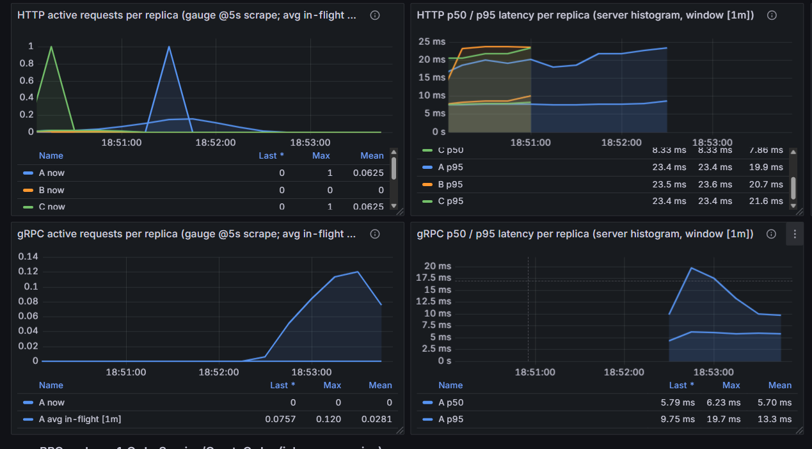
*Figure 2. Stage 1 baseline, active requests and p50/p95 latency, same range.* Only A carries baseline traffic. The
B and C HTTP latency lines before about 18:51 are from the earlier traffic **(a)**. Results: client p95 27.49 ms
(HTTP), 17.04 ms (gRPC); average in-flight on A 0.17 (HTTP), 0.13 (gRPC); B and C 0.

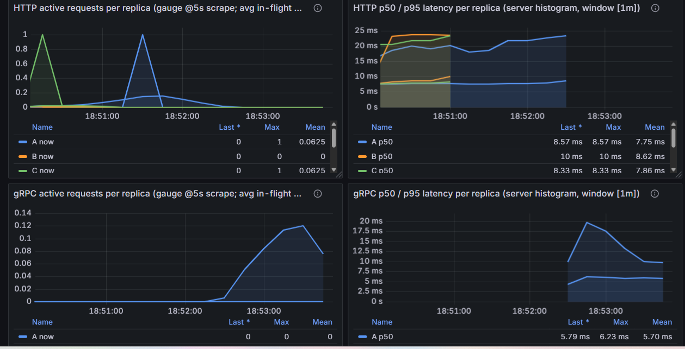
*Figure 3. Stage 1 baseline, the same panels as Figure 2 with the latency legend showing p50 instead of p95
(18:50–18:53 PKT).* This was saved as `Screenshot 2026-11-15 184136.png` and renamed.

### Stage 2: round robin (HTTP 18:54:12–18:55:12, gRPC 18:55:58–18:56:58)

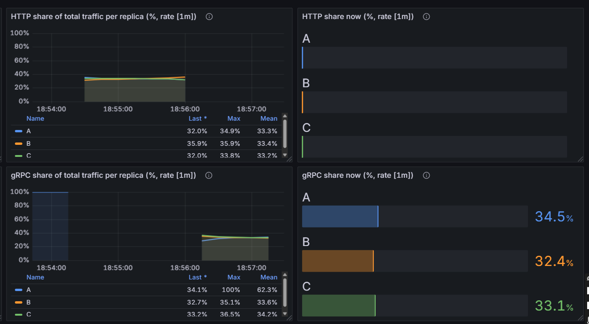
*Figure 4. Stage 2 round robin, share panels, axis about 18:53:40–18:57:30 PKT.* HTTP's three lines stay close to
33%. On the left of the gRPC chart, the 100% A line is the end of the gRPC baseline **(a)**. The HTTP "share now" bars
are empty **(b)**. Results: exactly 400/400/400 on both interfaces (33.3% each), and the gRPC client used one
connection.

### Stage 3: weighted round robin 2:1:1 (HTTP 18:57:50–18:58:50, gRPC 18:59:35–19:00:35)

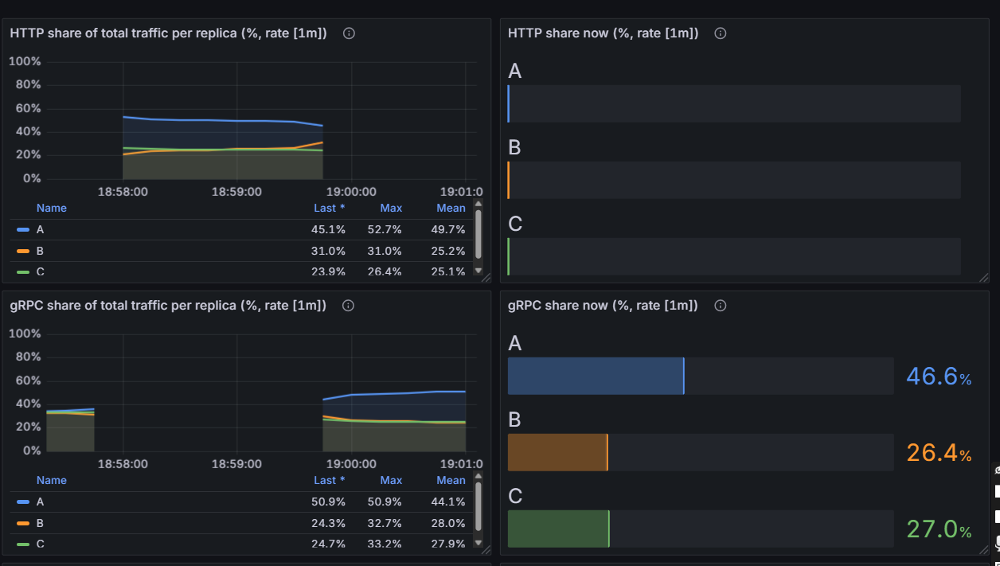
*Figure 5. Stage 3 weighted 2:1:1, share panels, axis about 18:57:30–19:01 PKT.* A is near 50% and B and C are near
25% for both interfaces. The short gRPC segment around 18:57–18:58 is the end of the stage 2 gRPC round-robin
run **(a)**. The HTTP bars are empty **(b)**. Results: HTTP 600/299/301 (50.0/24.9/25.1%), gRPC 600/300/300.

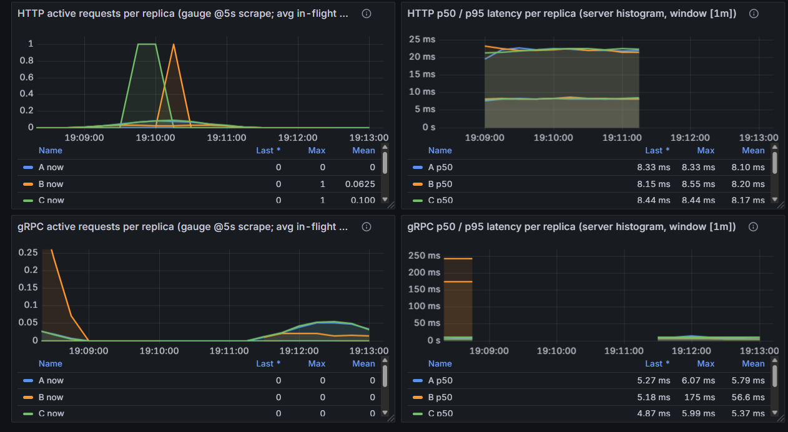
*Figure 6. **Wrong time range: this image does not show stage 3.** Its axis covers about 19:08:30–19:13 PKT, which
is the stage 6 failure window (it shows the same HTTP active-request spikes as Figure 12). The stage 3 latency /
active-requests screenshot (18:57:50–19:00:35) is **NOT COLLECTED**.* Stage 3 results come from the files instead:
average in-flight HTTP 0.07/0.03/0.04 and gRPC 0.06/0.03/0.03; server p95 HTTP 14.6/13.3/12.6 ms and gRPC
9.7/9.7/9.6 ms; client p95 22.2 ms and 11.59 ms.

### Stage 4: round robin with B delayed 200 ms (HTTP 19:01:32–19:02:32, gRPC 19:03:18–19:04:18)

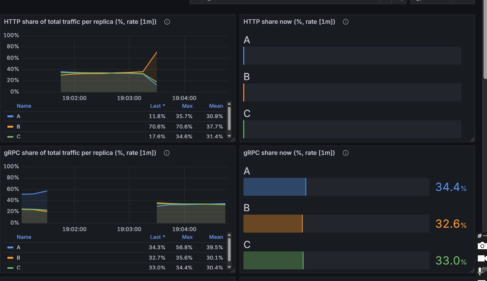
*Figure 7. Stage 4 RR with B +200 ms, share panels, axis about 19:01–19:04:45 PKT.* All three replicas stay near a
third during the run. The jump in B's HTTP share at the right end of the HTTP line (about 19:03:30) is a
window-edge effect **(a)**: by then the 1-minute window holds only the last seconds of the run. It does not show a
change in routing. The gRPC segment on the left is the tail of stage 3 (A near 50%) **(a)**. The HTTP bars are
empty **(b)**. Results: HTTP 401/400/399, gRPC 400/400/400.

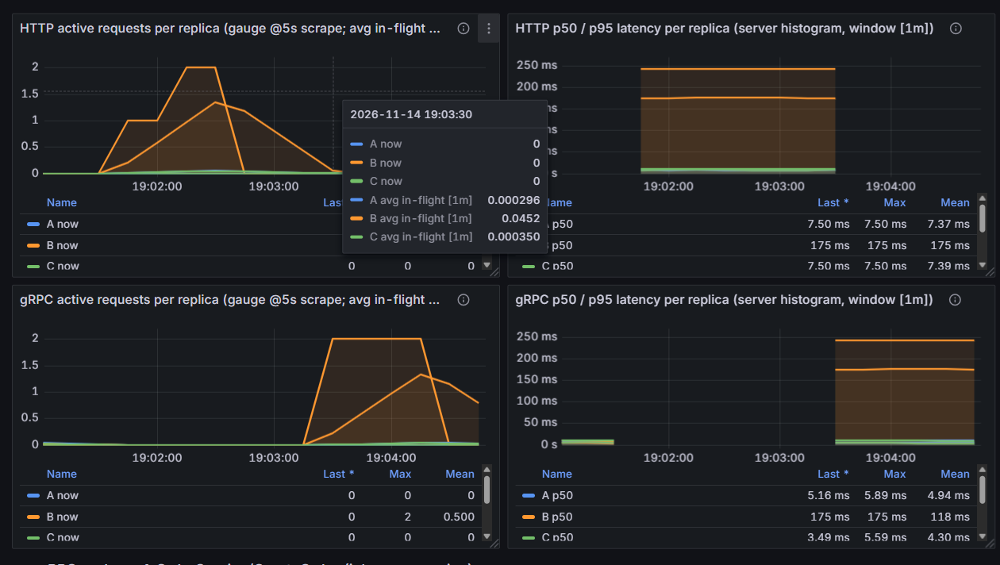
*Figure 8. Stage 4, active requests and p50/p95 latency, same range.* Only B's latency band is high, and only B has
requests in flight, while A and C stay near 0. Results: B's server p95 242.9 ms and average in-flight 1.38 (HTTP)
and 1.37 (gRPC); A and C about 0.04; client p95 220.52 ms (HTTP) and 210.48 ms (gRPC).

### Stage 5: least request with B delayed 200 ms (HTTP 19:05:09–19:06:09, gRPC 19:06:52–19:07:52)

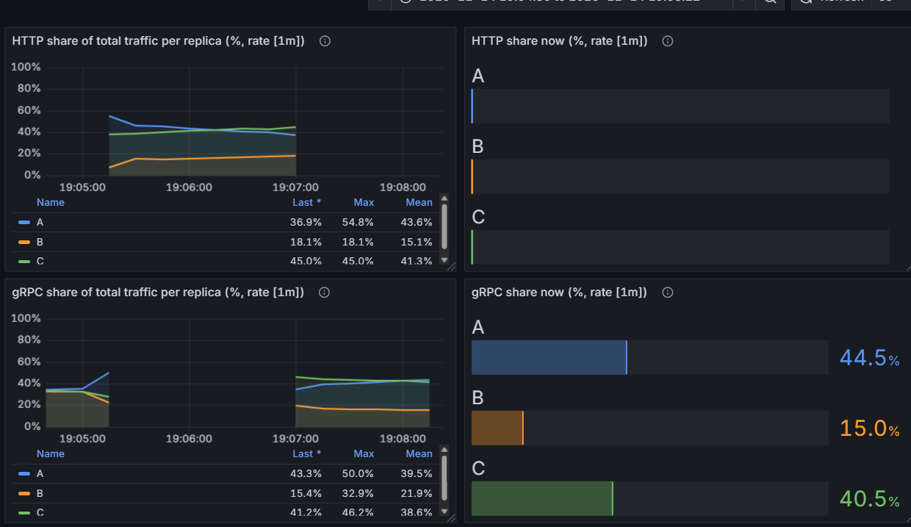
*Figure 9. Stage 5 least request with B +200 ms, share panels, axis about 19:04:40–19:08:20 PKT.* B's share drops
well below a third on both interfaces, and A and C rise above it. The first point of the HTTP line and the gRPC
segment on the left still include stage 4 traffic **(a)**. The HTTP bars are empty **(b)**. Results: HTTP
510/192/498 (42.5/16.0/41.5%), gRPC 504/189/507 (42.0/15.8/42.2%).

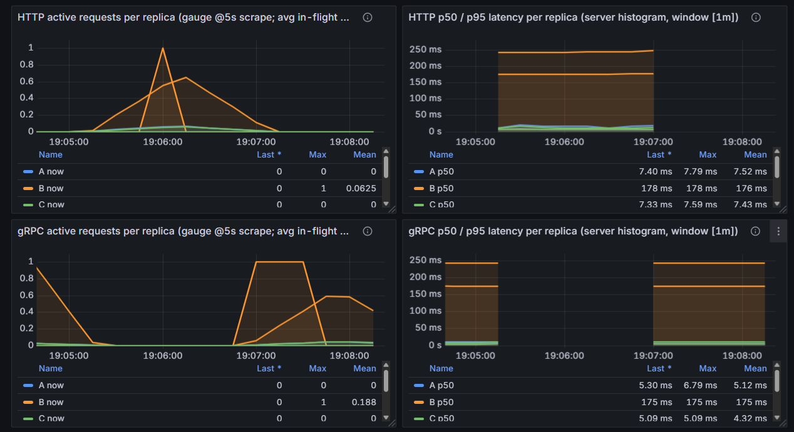
*Figure 10. Stage 5, active requests and p50/p95 latency, same range.* B's latency band is unchanged (the delay is
the same), but B has fewer requests in flight than in Figure 8. The gRPC B band on the left (before about
19:05:15) is from stage 4 **(a)**. Results: B's average in-flight 0.67 (HTTP) and 0.65 (gRPC), down from 1.38 and
1.37; B's server p95 243.2 and 242.5 ms; client p95 218.77 and 209.84 ms.

### Stage 6: failure and recovery (HTTP 19:08:49–19:10:19, gRPC 19:11:12–19:12:42)

B was stopped and started at these times (from `d3-fail-*.events.json`, converted to PKT). HTTP: `stop` returned
19:09:19.8, B unhealthy 19:09:27.1, `start` returned 19:09:50.3, B healthy 19:09:54.3. gRPC: `stop` returned
19:11:42.4, B unhealthy 19:11:49.7, `start` returned 19:12:12.8, B healthy 19:12:17.8.

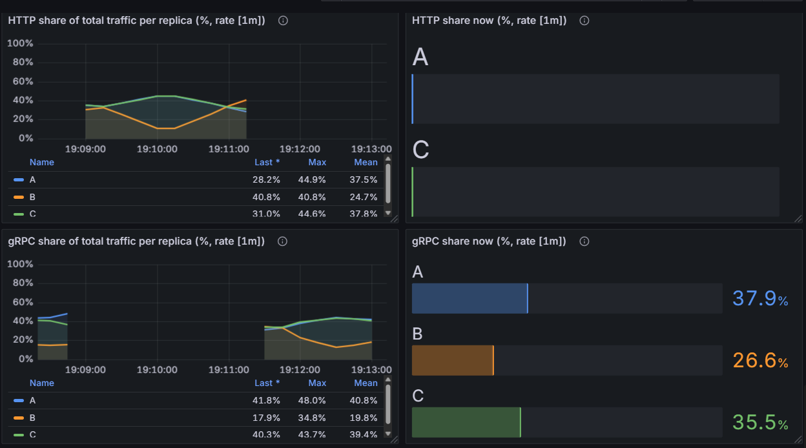
*Figure 11. Stage 6 failure and recovery, share panels, axis about 19:08:30–19:13 PKT.* B's share drops while it is
stopped and A and C rise, then B returns after the restart. Because of the 1-minute window **(a)**, the dip lags
the stop/start times by up to 60 s, and it is shallower than the real 0 requests that B received between removal
and recovery. The gRPC segment on the left is stage 5 traffic (B low because of least request) **(a)**. The HTTP
"share now" panel shows only A and C with empty bars **(b)**. Results: HTTP 40.1/19.9/40.0%, gRPC 39.7/20.8/39.6%
(Prometheus). B received 0 requests from second 38 of the run until about second 64 (HTTP) or 65 (gRPC).

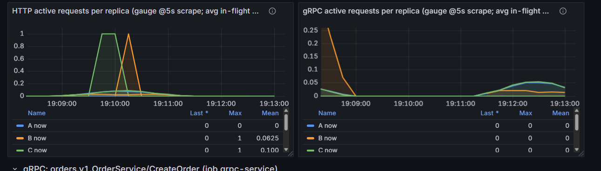
*Figure 12. Stage 6, **active requests** per replica (HTTP and gRPC), same range. The file name says "rate", but the
image shows the active-requests panels, not the request-rate panels.* The gRPC B line at the far left is
stage 5's delayed B **(a)**. The single HTTP spikes to 1 near 19:10 are 5-second gauge samples. They are not
failures.

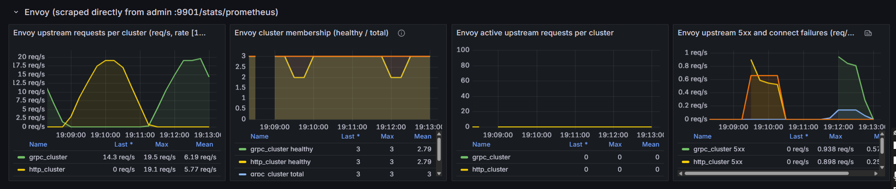
*Figure 13. Stage 6, Envoy panels, axis about 19:08:30–19:13 PKT.* Cluster membership drops from 3 to 2 healthy
hosts and returns to 3, once for `http_cluster` and once for `grpc_cluster` (Prometheus saw 3 → 2 → 3 at 19:09:29 /
19:09:59 for HTTP and 19:11:57 / 19:12:22 for gRPC). The **upstream 5xx and connect-failure panel** is the only
place the failures appear **(c)**: 51 HTTP 503s and 51 gRPC `UNAVAILABLE`, all with flag `UF` (2.83% each). The gap
at the far left of the membership panel is Envoy being restarted before the run.

### Log examples (Kibana)

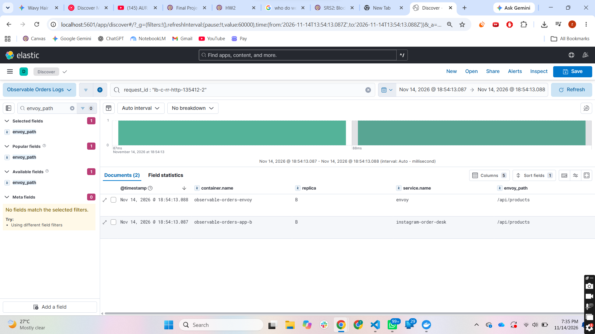
*Figure 14. Stage 2 round robin, Kibana Discover, query `request_id : "lb-c-rr-http-135412-2"`, range
18:54:13.087–18:54:13.088 PKT.* Two documents: `observable-orders-envoy` (service `envoy`, replica B) and
`observable-orders-app-b` (service `instagram-order-desk`, replica B), both for `/api/products`. These are the same
two events as in `docs/a3/log-example-http.json`.

**a3-kibana-grpc-envoy-replica.png: NOT COLLECTED.** It should show KQL `request_id : "lb-c-rr-grpc-135558-2"`
(stage 2 gRPC, run started 18:55:58 PKT). The saved Elasticsearch response (`docs/a3/log-example-grpc.json`) shows 4
events: the Envoy event (replica C, `grpc_status` OK) and 3 events from `grpc-c` (received, order 682 replayed,
completed).

### Whole-experiment overviews (Grafana "Last 30 minutes", axis about 18:53–19:23 PKT)

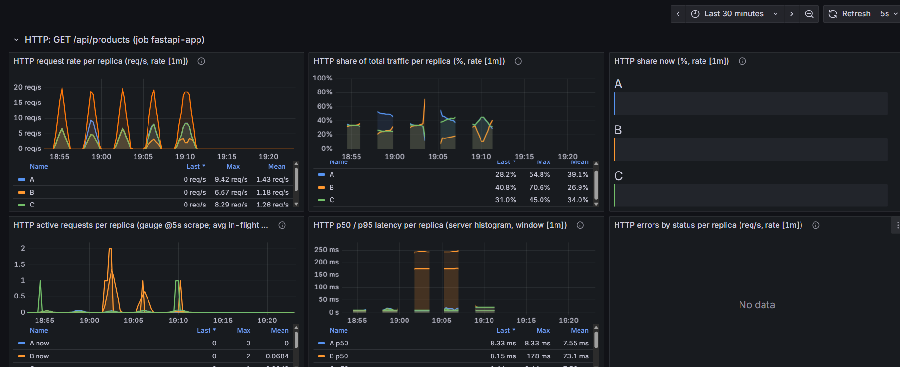
*Figure 15. HTTP row, all stages.* Five HTTP bursts, from stage 2 (about 18:54) to stage 6 (about 19:09). Stage 1
HTTP (18:50:36) is before the left edge. The latency chart shows the two high bands from stages 4 and 5 (B
+200 ms). The HTTP errors-by-status panel shows **No data** for the whole range, including the failure stage
**(c)**. The HTTP "share now" bars are empty **(b)**.

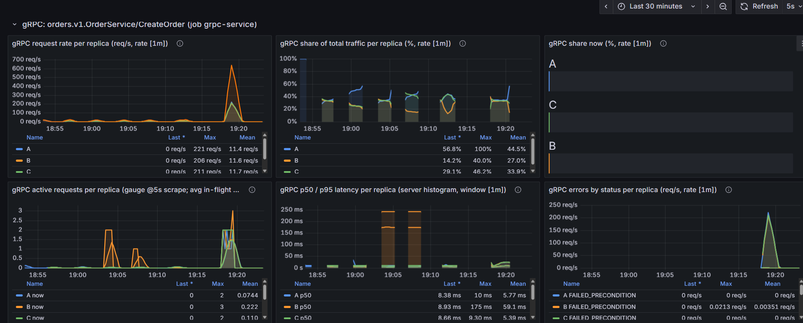
*Figure 16. gRPC row, all stages.* Each experiment shows as a small burst at 20 req/s, and the delayed-B bands
appear in stages 4 and 5. There is **no** `UNAVAILABLE` in the errors panel during stage 6 **(c)**. The large spike
around 19:18–19:20 (hundreds of req/s, with `NOT_FOUND`/`FAILED_PRECONDITION`/`INVALID_ARGUMENT` errors) comes
**after** the last experiment ended at 19:12:42. It is not part of any run in `results/`. It matches the
post-experiment functional checks (`grpc_traffic.py`, `grpc_concurrent.py`) recorded in `docs/a3/progress.md`.

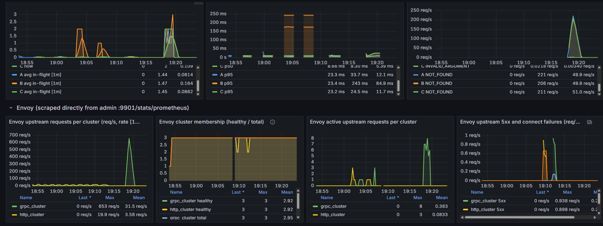
*Figure 17. Lower gRPC panels and the Envoy row, all stages.* In the Envoy membership panel, both clusters are
at 3 healthy hosts, except for two short drops to 2 in stage 6 (HTTP then gRPC). The gap just before stage 6 is
the Envoy restart. The upstream 5xx panel has values only in stage 6 **(c)**. The large Envoy gRPC spike after
19:15 is the same post-experiment check traffic as in Figure 16.

## 7. Conclusions

1. **Strategy.** For **HTTP** I would use **least request** (with active health checks): with equal replicas
   it matched RR, and when B was slow it moved half of B's traffic away and cut the mean from 83.8 to 49.6 ms
   with no configuration change. For **gRPC** I would also use **least request** over an **HTTP/2 listener**.
   Per-call routing is the necessary part (one client connection still gave 400/400/400), and least request
   gave the same benefit (mean 76.0 → 41.0 ms, B 15.8%). Health checks are needed for both: without them a
   stopped replica would keep receiving a third of the traffic. Least request does not fix p95 on its own. For
   that I would add outlier detection or latency-aware ejection.
2. **Where I would choose differently.** For cache-heavy or session-sticky traffic (for example product lookups
   where each replica caches its own products), I would use **consistent hashing (ring hash / Maglev)** on
   product ID or session, so the same key always reaches the same warm replica, at the cost of less even load.
   For a fleet of genuinely different machines, **weighted** RR matched the configured split exactly (50/25/25).
   It is the simplest predictable choice when capacity is known and requests cost about the same.
3. **If Envoy stops,** every client loses both HTTP :8000 and gRPC :50051 at once. The replicas stay healthy
   but unreachable, because Envoy is a single point of failure. Improvement: run **two Envoy instances** behind
   a virtual IP (keepalived/VRRP) or DNS with health checking (or a cloud L4 load balancer), each with the same
   generated config, so one can fail or be restarted for a config change without an outage. Clients would also
   need a retry for idempotent calls during failover.

## 8. Limits and evidence still to collect

- Grafana screenshots for every stage are in section 6, except the stage 3 latency/active-requests view, which is
  **NOT COLLECTED**. The file `a3-3-weighted-211-latency.png` shows the stage 6 time range instead.
- Kibana: the HTTP search screenshot is included. The gRPC one (`a3-kibana-grpc-envoy-replica.png`) is
  **NOT COLLECTED**, so the raw Elasticsearch response in `docs/a3/log-example-grpc.json` is the evidence.
- One run per configuration at one load (20 req/s), on one laptop. All six replicas share one CPU and one SQLite
  file, so the results show routing behaviour, not capacity. At 20 req/s nothing was saturated.
- The failure test stopped B's HTTP and gRPC containers together, so both clusters lost B at the same moment.
- The server-side p50/p95 values are interpolated from histogram buckets (default HTTP buckets; gRPC buckets
  5 ms to 1 s), so a value such as 242.9 ms means "in the 0.1-0.25 s bucket", not an exact measurement.
- Optional consistent-hashing experiment: not done.
