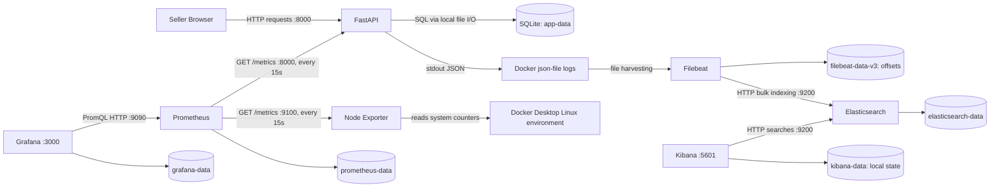

# PART A — PROJECT

Small Instagram sellers may track orders through messages and spreadsheets, making stock availability and fulfilment difficult to manage. This project provides a browser-based order desk for these sellers. FastAPI handles requests and SQLite stores products, inventory and orders. It is a local demonstration, not an Instagram messaging or payment integration.

The application supports product variants, stock updates, order creation, insufficient-stock rejection, and fulfilment through PENDING → PACKED → SHIPPED → COMPLETED. A pending order reserves stock; packing deducts physical stock. Cancellation releases reservations or restores deducted stock, depending on the order state. Completed and cancelled orders are terminal.

To try it, install Docker Desktop with Linux containers, open PowerShell in the repository and run:

```powershell
docker compose up -d --build
docker compose ps
```

Open http://localhost:8000, create a product with stock, create an order, and change its status. API documentation is at http://localhost:8000/docs. With Python installed, `python scripts/normal_traffic.py --count 60 --interval 1` generates repeatable normal traffic; see [README](../README.md) for setup, usage and cleanup. `docker compose stop` stops services while retaining data.

The [saved audit](final-assignment-audit.md) records 15 passing Python tests on both host and container, plus a JavaScript markup regression check. Its normal workload accepted 60 orders, completed 30, cancelled 30 and rejected six insufficient-stock attempts. These results support application behavior; they are not browser screenshots.

# PART B — METRICS

Prometheus requests `/metrics` from FastAPI and Node Exporter every **15 seconds**, storing timestamped samples. Grafana queries that data and presents charts. Their interfaces are http://localhost:9090 and http://localhost:3000; the provisioned dashboard is **Observable Instagram Orders**.

### Metric table

Definitions are in [app/metrics.py](../app/metrics.py); the recording functions below are in [app/main.py](../app/main.py).

| Metric | Purpose | Type | Unit | Application labels | Where/how recorded |
|---|---|---|---|---|---|
| `http_requests_total` | Traffic and failures | Counter | requests | `method`, `route`, `status_code` | `record_http_metrics`: increment per response, including uncaught 500 errors |
| `http_request_duration_seconds` | HTTP response latency | Histogram | seconds | `method`, `route` | Same middleware observes elapsed `perf_counter()` time |
| `orders_created_total` | Accepted orders | Counter | orders | none | `add_order`: increment after successful database commit |
| `orders_completed_total` | Fulfilled orders | Counter | orders | none | `update_order_status`: increment on successful COMPLETED transition |
| `orders_cancelled_total` | Cancelled orders | Counter | orders | none | Same function on successful CANCELLED transition |
| `orders_rejected_total` | Business-rule rejections | Counter | attempts | none | `add_order`: increment when handling `BusinessRuleError` |
| `pending_orders` | Unfinished seller work | Gauge | orders | none | `update_pending_orders`: set from SQLite at startup and after creation/status changes |
| `order_processing_seconds` | Creation-to-terminal lifecycle time | Summary | seconds | `terminal_status` | `update_order_status`: observe `processing_seconds(order)` for COMPLETED/CANCELLED |

Counters accumulate until process restart; a Gauge can rise or fall. The Histogram exposes cumulative buckets, sum and count. Python's Summary exposes sum/count, **not percentiles**. Lifecycle time is different from HTTP latency, and SQLite's second-resolution creation timestamp affects very short synthetic lifecycle measurements. Routes normalize numeric IDs; request/order IDs are excluded from production metric labels. Prometheus additionally attaches `job` and `instance`.

### Charts and queries

These expressions match the [dashboard](../grafana/dashboards/observable-orders.json). `$__rate_interval` is Grafana's calculated lookback window; it is not necessarily the whole displayed time range. For the saved audit queries it was replaced with **5m**.

| Chart | PromQL | Meaning |
|---|---|---|
| Order totals and backlog | `orders_created_total`, `orders_completed_total`, `orders_cancelled_total`, `orders_rejected_total`, `pending_orders` (separate panels) | Process totals and current database backlog |
| Creation rate | `rate(orders_created_total[$__rate_interval])` | Accepted orders per second |
| Traffic by route | `sum by (route) (rate(http_requests_total[$__rate_interval]))` | Requests per second for each route |
| HTTP errors | `100 * (sum(rate(http_requests_total{status_code=~"4..|5.."}[$__rate_interval])) or vector(0)) / clamp_min(sum(rate(http_requests_total[$__rate_interval])), 1e-9)` | Percentage of responses with 4xx/5xx status |
| Mean HTTP latency | `sum(rate(http_request_duration_seconds_sum[$__rate_interval])) / sum(rate(http_request_duration_seconds_count[$__rate_interval]))` | Average server response duration |
| HTTP p95 | `histogram_quantile(0.95, sum by (le) (rate(http_request_duration_seconds_bucket[$__rate_interval])))` | Estimated duration below which 95% of observed requests fall |
| Lifecycle average | `sum by (terminal_status) (rate(order_processing_seconds_sum[$__rate_interval])) / sum by (terminal_status) (rate(order_processing_seconds_count[$__rate_interval]))` | Summary average for orders reaching each terminal state; undefined without terminal events |

The histogram p95 estimates a percentile by interpolation within buckets. This report uses **p95**, not an unmeasured p99. At the [audit capture](audit-evidence/live-observability.json), **2026-09-23 08:08:16 UTC**, the five-minute queries returned mean HTTP latency **13.542 ms**, p95 **24.756 ms**, and lifecycle averages **1.546 s COMPLETED / 1.523 s CANCELLED**. All 16 expressions across 14 panels returned backend data; Grafana rendering was not verified.

### Node Exporter and project-specific exploration

Node Exporter reads Linux system statistics. The measured machine is the **Docker Desktop Linux/WSL2 environment visible to its container**, not the entire native Windows host or just FastAPI.

| Signal | Metric/type/unit and collection | Dashboard query | Audit result |
|---|---|---|---|
| CPU | `node_cpu_seconds_total`: Counter, seconds, labels `cpu`/`mode`; Linux CPU counters | `100 * (1 - avg by (instance) (rate(node_cpu_seconds_total{job="node-exporter",mode="idle"}[$__rate_interval])))` | 3.343% busy |
| Memory | `node_memory_MemAvailable_bytes`, `node_memory_MemTotal_bytes`: Gauges, bytes; Linux memory statistics | `100 * (1 - node_memory_MemAvailable_bytes{job="node-exporter"} / node_memory_MemTotal_bytes{job="node-exporter"})` | 37.134% |
| Disk | `node_filesystem_avail_bytes`, `node_filesystem_size_bytes`: Gauges, bytes; filesystem statistics with device/fstype/mountpoint labels | `100 * (1 - node_filesystem_avail_bytes{job="node-exporter",fstype="ext4",mountpoint="/mnt/docker-desktop-disk"} / node_filesystem_size_bytes{job="node-exporter",fstype="ext4",mountpoint="/mnt/docker-desktop-disk"})` | 5.786% |
| Network | `node_network_receive_bytes_total`, `node_network_transmit_bytes_total`: Counters, bytes, `device`; interface statistics | `sum by (device) (rate(node_network_receive_bytes_total{job="node-exporter",device!~"lo"}[$__rate_interval]))`; replace `receive` with `transmit` for outbound | eth0: 47.287 B/s received, 979.922 B/s sent |

The project-specific comparison is **pending backlog versus lifecycle duration**: a fast API can still leave sellers with unfinished orders. The audit returned 16 pending orders, including existing data, while short synthetic completed/cancelled lifecycles had the averages above. This does not measure human fulfilment speed.

Grafana visual evidence has now been added: [order counters and pending gauge](screenshots/Screenshot%202026-09-23%20180439.png), [completed orders and creation rate](screenshots/Screenshot%202026-09-23%20180447.png), [request rate and HTTP errors](screenshots/Screenshot%202026-09-23%20180500.png), [response latency and p95](screenshots/Screenshot%202026-09-23%20180843.png), [lifecycle Summary](screenshots/Screenshot%202026-09-23%20180921.png), [CPU](screenshots/Screenshot%202026-09-23%20180900.png), [memory](screenshots/Screenshot%202026-09-23%20180935.png), [disk](screenshots/Screenshot%202026-09-23%20180910.png), and [network](screenshots/Screenshot%202026-09-23%20180944.png). These show rendered dashboard panels with real data. The screenshots do not show expanded PromQL or the exact selected time range, so those details remain a presentation limitation. My backlog/lifecycle comparison and interpretation are documented above.

# PART C — LOGS

[app/logging_config.py](../app/logging_config.py) formats JSON. [app/main.py](../app/main.py) logs request outcomes, order creation/status changes, stock changes, validation/business rejections and unexpected errors. These explain what happened and connect related events using `request_id`; business events can also include `order_id`. INFO records normal outcomes, WARNING expected problems/test injections, and ERROR unexpected failures. Intended fields exclude request bodies, customer references and sensitive exception text; tests check these exclusions. Correlation IDs must not contain personal information.

### Original event → stored fields → search

This actual order-created event belongs to order **20**:

```json
{"message":"order created","order_id":20,"request_id":"pipeline-proof-20260922171843","service":{"name":"instagram-order-desk"},"severity":"INFO","timestamp":"2026-09-22T12:18:43.875352+00:00"}
```

Docker's `json-file` driver wrapped the line as an escaped string in `log`, with `stream="stdout"` and `time="2026-09-22T12:18:43.87593895Z"`. Filebeat's container parser unwraps this outer envelope. It attaches Docker metadata, keeps `container.name="observable-orders-app"`, decodes the inner JSON into temporary `json`, copies searchable fields, then removes `json`.

The [actual Elasticsearch document](../diagnostics/milestone7/actual-document.json) contains the following selected `_source` fields. The retained `message` is the **whole original JSON string**, not just “order created”:

```json
{
  "@timestamp": "2026-09-22T12:18:43.875Z",
  "service": {"name": "instagram-order-desk"},
  "severity": "INFO",
  "request_id": "pipeline-proof-20260922171843",
  "order_id": 20,
  "container": {"name": "observable-orders-app"},
  "message": "{\"message\":\"order created\",\"order_id\":20,\"request_id\":\"pipeline-proof-20260922171843\",\"service\":{\"name\":\"instagram-order-desk\"},\"severity\":\"INFO\",\"timestamp\":\"2026-09-22T12:18:43.875352+00:00\"}\n"
}
```

`@timestamp` comes from Docker capture time; the more precise application timestamp remains inside `message`. Service and container are objects, order ID is numeric, and request ID/severity are keyword fields. An earlier indexing failure occurred because scalar `service` conflicted with Elasticsearch's object mapping; using `service.name` fixed it without changing the v3 pipeline. App-container Uvicorn access lines are plain text and are not transformed into these structured business fields.

In Kibana at http://localhost:5601, select **Observable Orders Logs**, pattern `observable-orders-v3-*`, time field `@timestamp`. Set **2026-09-22 12:18:00–12:20:00 UTC** and use these separate KQL searches:

```kql
request_id : "pipeline-proof-20260922171843"
order_id : 20
request_id : "pipeline-proof-20260922171843" and severity : "INFO"
request_id : "pipeline-proof-20260922171843-rejected" and message : "order rejected"
```

Elasticsearch searches returned respectively **2, 1, 2 and 1** matching documents in the saved proof. For unexpected errors, use `severity : "ERROR"` over a relevant range; this query does not imply an ERROR document was observed. [Saved queries](kibana-queries.kql) provide further examples.

[Prometheus target evidence is available in [promethues.png](screenshots/promethues.png), showing both `fastapi-app` and `node-exporter` as UP. Kibana Discover evidence is available in [Kibana.png](screenshots/Kibana.png), showing the `Observable Orders Logs` data view and 178 indexed documents. The screenshot uses a recent 15-minute range, not the saved proof range. A filtered proof-request search, rejected-order search, and expanded order-20 document are still needed for complete Part C visual evidence.]

### Persistence and deletion

Raw logs live in Docker-managed container files. They survive restarting the same container but may be removed with it. Filebeat's persistent registry remembers read offsets; it is not a log archive. Elasticsearch stores indexed copies in `elasticsearch-data`, surviving container recreation while that volume remains. Kibana saved searches/data views primarily live in Elasticsearch; Kibana is a search interface, not a second log store.

Inspection found no Docker log-rotation options and no configured age-based retention for the v3 Elasticsearch data. Old indexed logs therefore have no scheduled age deletion in this setup. Deliberate index/data-stream deletion removes indexed history; deleting volumes removes persisted data. Preserve evidence before cleanup and follow README instructions; ordinary `stop` or `down` without `-v` preserves named volumes.

# PART D — SYSTEM DESIGN

Arrows below show the initiator of requests or the direction of written data. HTTP responses return along the same connection.



### Responsibilities, choices and failures

| Component | Responsibility, communication and storage | Why used; if it stops |
|---|---|---|
| Browser | Seller sends HTTP actions to FastAPI; no authoritative business storage | Familiar interface; an outage prevents that user interacting |
| FastAPI | Validates requests, calls SQLite, emits logs and exposes metrics; counters are process memory | Python API and instrumentation fit this small project; if down, order actions and app scrapes fail |
| SQLite | Stores products/orders/inventory in `/app/data/orders.db`, volume `app-data` | Simple transactional local storage; unavailable DB prevents business operations; losing the volume loses records |
| Docker | Runs services and saves stdout logs outside repository | Reproducible local stack; engine failure stops the stack; container removal can lose raw logs |
| Node Exporter | Reads Linux counters for Prometheus; no historical store | Standard infrastructure exporter; if down, infrastructure samples stop |
| Prometheus | Pulls metric samples into `/prometheus`, volume `prometheus-data` | Time-series storage and PromQL; if down, new samples are missed and Grafana queries fail, while orders can continue |
| Grafana | Queries Prometheus; `/var/lib/grafana`, volume `grafana-data`, plus provisioned configuration | Shared dashboards; if down, charts disappear but collection can continue |
| Filebeat | Reads Docker files and sends events to Elasticsearch; `filebeat-data-v3` stores offsets | Collects container logs independently of app code; if down, shipping pauses and recovery depends on raw files still existing |
| Elasticsearch | Indexes logs/searches; `/usr/share/elasticsearch/data`, volume `elasticsearch-data` | Searchable event fields; if down, indexing/search stop, with buffering/retry limited by available resources and retained logs |
| Kibana | Queries Elasticsearch; volume `kibana-data` holds local state, saved objects primarily reside in Elasticsearch | Discover provides interactive searches; if down, the UI is unavailable although indexing can continue |

This is a single-machine teaching deployment with no demonstrated backup, failover or production-scale capacity. Monitoring failures generally do not undo committed orders. [Detailed design](part-d-system-design.md) provides further explanations and questions for revision.

### One complete metric journey

`add_order` in `app/main.py` calls `ORDERS_CREATED.inc()` after successful creation. The Counter defined in `app/metrics.py` is exposed at `/metrics`; the [saved exposition](part-d-evidence/metrics.txt) contained **`orders_created_total 5.0`**. Prometheus scraped `app:8000`, attached target labels, and stored samples in its TSDB. The query **`orders_created_total`** returned **5** in the [saved response](part-d-evidence/prometheus-orders-created.json). Grafana's **Orders created** panel uses that query. This is a process count from the earlier Part D capture, not order ID 5 or the later audit total of 60.

The Grafana [Orders created and pending orders screenshot](screenshots/Screenshot%202026-09-23%20180439.png) provides rendered visual evidence for the dashboard panel. Its displayed value reflects the later normal-traffic run rather than the earlier saved Prometheus value of 5, so the two observations should not be treated as a timestamp-matched pair. The [Prometheus targets screenshot](screenshots/promethues.png) also confirms that the FastAPI scrape target was UP when the dashboard evidence was collected.

### One complete log journey

For order 20, `add_order` writes “order created” through the JSON logger → stdout → Docker's escaped `log` envelope → Filebeat's container parsing and temporary JSON decoding → Elasticsearch's typed fields → Kibana's exact request-ID search. Part C shows the actual values, format changes and query. The [Kibana Discover screenshot](screenshots/Kibana.png) confirms the configured data view and indexed documents; the current screenshot does not include the exact proof-request, rejected-order, or expanded-document views.

Personal explanation requirement: before submission, review the design choices and be prepared to explain any tool behavior that remains unclear in your own words.

# PART E — EXPERIMENTS

### Experiment 1: controlled latency

The local fault in [app/experiment_fault.py](../app/experiment_fault.py) uses `asyncio.sleep(0.5)` on every fifth order-creation request. It is disabled by default and requires both startup `PART_E_TEST_MODE=controlled-local-only` and a fresh control-file token `ENABLE_500MS_EVERY_5TH`. The token expires after five minutes; the runner disables it afterward. The explicit Compose override supplies the test mount/gate. Normal Compose startup does not enable it.

**Method.** Run `parte-20260922` used the same script hash and workload for normal, fault and recovery: 90 measured one-unit orders scheduled one second apart, with sufficient stock, one excluded warmup and 35-second waits around collection. Each phase contained six healthy scrapes per target. No unrelated traffic should be added during reproduction.

Commands used from the repository root are below. For a new run, replace `parte-20260922` consistently; existing evidence must not be overwritten. Write predictions after normal and before fault, and analysis before recovery, following the [full procedure](part-e-controlled-problem.md).

```powershell
Set-Content experiments/control/latency.txt DISABLED
docker compose -f docker-compose.yml -f docker-compose.experiment.yml up -d --build app
docker compose up -d prometheus node-exporter grafana elasticsearch filebeat kibana
python scripts/part_e_workload.py --phase normal --run parte-20260922 --ack-test-data
# Save predictions.md in this run's evidence directory BEFORE the next command.
python scripts/part_e_workload.py --phase fault --run parte-20260922 --ack-test-data
# Record analysis-before-recovery.md before recovery.
Set-Content experiments/control/latency.txt DISABLED
python scripts/part_e_workload.py --phase recovery --run parte-20260922 --ack-test-data
python scripts/part_e_verify.py parte-20260922
docker compose -f docker-compose.yml up -d --no-deps --force-recreate app
```

**Prediction, preserved before fault.** The [original prediction](../experiments/results/parte-20260922/predictions.md) was locked at **2026-09-22 12:54:04.962653 UTC**. It predicted about **100 ms** extra mean latency (20% × 500 ms), client mean near **135.5 ms**, client p95 **530–560 ms**, roughly **1 request/s**, **zero errors**, no large sustained CPU increase, and **18 WARNING injection markers**. It also anticipated histogram p95 near **687.5 ms** because of bucket interpolation. Recovery should remove the markers and restore near-baseline latency. The saved prediction hash was verified unchanged.

All following times are **2026-09-22 UTC**. Prometheus values use a **120-second lookback ending at the listed evaluation time**, rather than only the 90-second traffic interval.

| Phase | Measured workload interval | Prometheus evaluation time |
|---|---|---|
| Normal | 12:50:47.101–12:52:17.102 | 12:52:32.102 |
| Fault | 12:54:40.038–12:56:10.038 | 12:56:25.038 |
| Recovery | 12:58:13.113–12:59:43.113 | 12:59:58.113 |

Actual [saved results](../experiments/results/parte-20260922/summary.json), rounded for presentation:

| Measurement | Normal | Fault | Recovery |
|---|---:|---:|---:|
| Client mean latency (ms) | 35.520 | 135.313 | 34.889 |
| Client nearest-rank p95 (ms) | 47.421 | 542.953 | 48.824 |
| Prometheus server mean (ms) | 17.869 | 119.653 | 18.373 |
| Prometheus histogram p95 (ms) | 24.250 | 687.500 | 24.574 |
| Client completed requests/s | ≈1.000 | ≈1.000 | ≈1.000 |
| Prometheus requests/s, 120s window | 0.824 | 0.857 | 0.857 |
| Successful orders / HTTP errors | 90 / 0 | 90 / 0 | 90 / 0 |
| App CPU (used cores) | 0.005334 | 0.005810 | 0.005429 |
| Visible Linux CPU (%) | 1.991 | 2.238 | 2.029 |
| Injection logs / indexed measured events | 0 / 180 | 18 / 198 | 0 / 180 |

The experiment used these actual PromQL expressions:

```promql
sum(increase(http_request_duration_seconds_sum{method="POST",route="/api/orders"}[120s])) / sum(increase(http_request_duration_seconds_count{method="POST",route="/api/orders"}[120s]))
histogram_quantile(0.95, sum by (le) (increase(http_request_duration_seconds_bucket{method="POST",route="/api/orders"}[120s])))
sum(rate(http_requests_total{method="POST",route="/api/orders"}[120s]))
100 * (sum(increase(http_requests_total{method="POST",route="/api/orders",status_code=~"4..|5.."}[120s])) or vector(0)) / clamp_min(sum(increase(http_requests_total{method="POST",route="/api/orders"}[120s])), 1)
rate(process_cpu_seconds_total{job="fastapi-app"}[120s])
100 * (1 - avg(rate(node_cpu_seconds_total{job="node-exporter",mode="idle"}[120s])))
```

Kibana comparisons use `request_id : parte-parte-20260922-normal-*`, then the equivalent `fault-*` and `recovery-*` prefixes in their corresponding windows. To find injected requests:

```kql
request_id : parte-parte-20260922-fault-* and message : "test-only order latency injected"
```

One [actual fault request](../experiments/results/parte-20260922/fault/example-request-005.json), `parte-parte-20260922-fault-005`, produced an injection warning, created order **120**, then logged HTTP **201** with **519.71 ms** duration. The warning's `500` is the configured wait, not a measured response duration.

**Analysis and recovery.** Client mean rose by **99.793 ms**, close to the predicted 100 ms, and client p95 fell within the predicted range. The server histogram's larger p95 reflects interpolation between the 0.5 and 0.75-second bucket limits; client and server timings also cover different boundaries. Prometheus rates include idle margins and scrape extrapolation, so their small difference is not evidence of improved throughput. Async sleep yields execution, consistent with the small observed CPU change, but one shared-host trial cannot isolate CPU effects.

For a seller, approximately one in five submissions would feel half a second slower and less consistent. This test demonstrated no failed orders or lost sales. Recovery restored near-baseline mean/p95 and zero injection markers. Cleanup cancelled all 273 test orders including warmups and restored fixture stock; the audit verified the startup gate removed and fault disabled.

Visual limitation: the saved experiment results are complete, but comparison screenshots for the normal/fault/recovery dashboard windows and corresponding Kibana searches are not included in the current evidence set.

### Experiment 2: request-ID cardinality

The [isolated test exporter](../experiments/cardinality/exporter.py) uses its own registry, Compose project and Prometheus on http://localhost:9091, with five-second scrapes. It does not create orders or modify production metrics. The first version uses `Counter("demo_requests_total", ..., ["request_id"])`; the second uses no application labels. Each accepted synthetic request increments once. Both versions used the same **100 unique IDs**, with exactly **100 requests per version**; no larger load or crash attempt was made.

Reproduction commands (use a new run name):

```powershell
$env:CARDINALITY_MODE='request-id'
docker compose -p cardinality-demo -f experiments/cardinality/compose.yml up -d --build --force-recreate exporter
docker compose -p cardinality-demo -f experiments/cardinality/compose.yml up -d prometheus
python experiments/cardinality/run.py --mode request-id --run cardinality-NEW
$env:CARDINALITY_MODE='no-label'
docker compose -p cardinality-demo -f experiments/cardinality/compose.yml up -d --no-deps --force-recreate exporter
python experiments/cardinality/run.py --mode no-label --run cardinality-NEW
python experiments/cardinality/verify.py cardinality-NEW
Remove-Item Env:CARDINALITY_MODE
```

The [saved experiment](cardinality-experiment.md) recorded these **post-scrape** results on **2026-09-23 UTC**:

| Version | Successful scrape | Query time | `count(demo_requests_total)` | `sum(demo_requests_total)` |
|---|---|---|---:|---:|
| With request ID | 07:53:04.200 | 07:53:04.806 | **100** | **100** |
| Without request ID | 07:53:24.200 | 07:53:24.895 | **1** | **100** |

A time series is a sequence of timestamped values identified by a metric name and its complete label set. Cardinality is the number of such distinct series. In version one, each ID created a different series with value 1. In version two, all requests incremented one series to 100. Prometheus's `job` and `instance` labels remained unchanged. The burst demonstrates the final series expansion; intermediate counts such as 10 or 50 were not recorded.

At **one million unique request IDs**, this design could create one million counter series for one target instead of one aggregate series. That is an extrapolation, not a measurement. Each identity adds memory/index overhead, recurring scrape samples, storage and query work; no bytes-per-series cost was measured. IDs belong in logs for individual-event investigation, while metric labels should describe bounded categories.

Removing the label does not delete history. After the next successful scrape, missing old series become stale and disappear from current instant results, but historical queries still find them until retention removes data. This run retained **101 label sets** across both versions, and the earlier count still returned 100. Test retention is seven days, so capture historical evidence before it expires. Fixed-time queries are:

```promql
count(demo_requests_total @ 1790149984.806)
count(demo_requests_total @ 1790150004.895)
sum(demo_requests_total @ 1790149984.806)
sum(demo_requests_total @ 1790150004.895)
```

Visual limitation: the saved cardinality verification proves the 100 → 1 result and retained history; test-Prometheus screenshots are not included in the current evidence set.

Sources and assistance are disclosed in [credits](credits.md). Review that disclosure against the course policy and add any additional sources or reused code actually used. The [requirement cross-check](final-report-crosscheck.md) maps each assignment requirement to this report and distinguishes complete evidence from current limitations.
