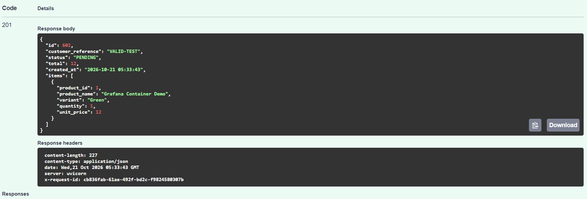
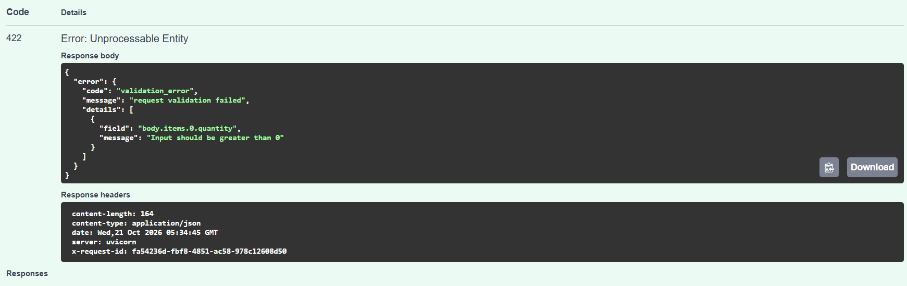
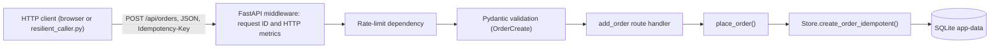
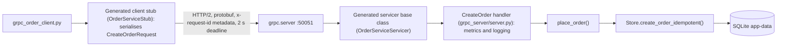
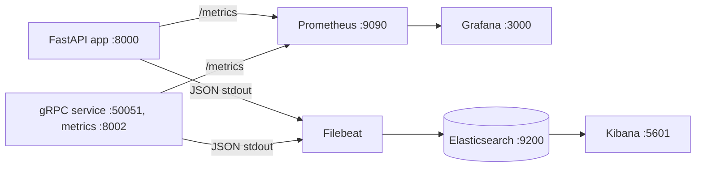
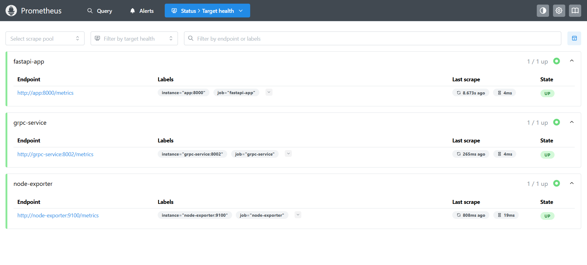
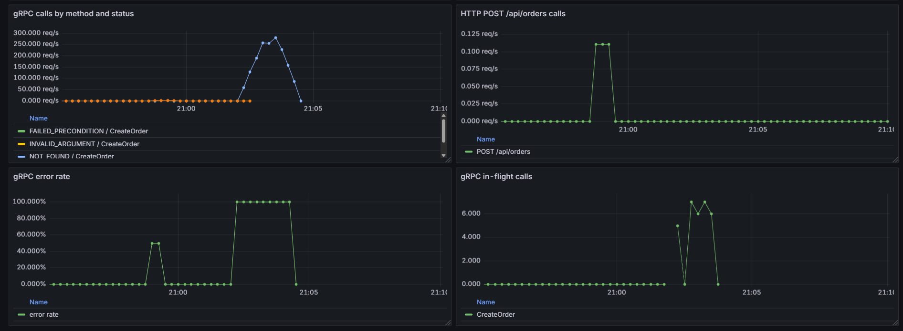
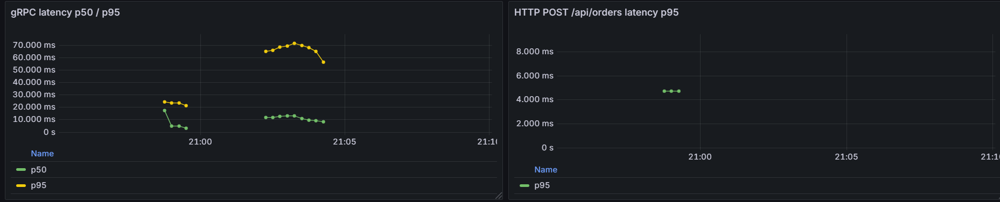
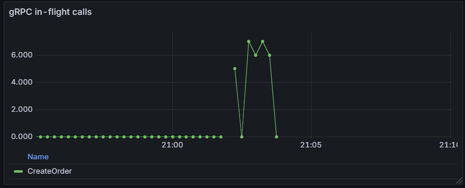

# Assignment 2 Report

Task chosen: **place an order** (HTTP `POST /api/orders`; gRPC `OrderService.CreateOrder`). See `docs/a2-scope.md`.

## 1. REST constraints

Source: lecture `APIs.md`, section 7.2.

| Constraint | Plain-language meaning | Example in my API |
|---|---|---|
| Client-server separation | The user interface and the backend are separate programs that only talk over HTTP. | The browser UI (`app.js`) and the Python caller both call FastAPI. Neither shares code or storage with the server. |
| Statelessness | The server keeps no per-client session between requests; each request carries what it needs. | `PATCH /api/orders/{order_id}/status` carries the order ID and new status. The DB holds order data, not session data. The rate limiter's per-IP counters are in memory, but they are request counters, not a client session, and are a single-instance simplification. |
| Cacheability | Responses say whether and how long they can be reused. | Not demonstrated: no `Cache-Control` headers are set, so responses do not declare how long they stay fresh. |
| Layered system | Proxies or gateways can sit between client and server without the client knowing. | Not demonstrated: clients call FastAPI directly. No proxy or gateway sits in the request path. |
| Uniform interface | Standard resource URIs, standard verbs on representations, self-descriptive messages, and hypermedia links. | Resource URIs (`/api/orders`, `/api/products/{id}/stock`), verbs GET/POST/PATCH, JSON bodies, status codes 201/404/409/422/429, and a uniform error body. Hypermedia links (HATEOAS) are not used, so the API is about Richardson level 2. |
| Code on demand (optional) | The server can send executable code to extend the client. | Optional and not part of the API: the server delivers `app.js` to the browser, but API clients do not depend on it. |

## 2. OpenAPI specification

The OpenAPI specification is a standard, machine-readable contract that describes an HTTP API's routes, inputs, headers and success and error responses. Tools use it to generate documentation, test requests and client code. I exported the specification from the FastAPI application to `docs/openapi.json`, then used the generated Swagger UI at `/docs` to send requests to `POST /api/orders` and compare the live responses with the documented ones.

### Inspection of `POST /api/orders`

- **Valid request (201 Created):** a valid order body returned the new `PENDING` order with its items and a request ID header.
- **Invalid input (422 Unprocessable Entity):** a negative quantity (`items.0.quantity`) was rejected with the standard error format, naming the failing field.





## 3. API before/after (task: place an order)

| | Before (Assignment 1) | After (Assignment 2) |
|---|---|---|
| Endpoint | `POST /api/orders` | `POST /api/orders` (same path) |
| Problem | A retried request could create a duplicate order and reserve stock twice. There was no limit on call rate. Insufficient stock and missing products both returned `400`, and errors used `{"detail": "..."}`. | Retries are protected with idempotency, bursts are limited, and errors now provide distinct statuses with one consistent error body. |
| Change | | Optional `Idempotency-Key` header: a repeat with the same key and body returns the original order (header `Idempotent-Replay: true`); the same key with a different body returns `422 idempotency_key_reuse`. Limit of 5 requests per 10 s per client IP, returning `429` with `Retry-After`. Missing product returns `404`, insufficient stock returns `409`, and every error uses `{"error": {"code", "message"}}`. |
| Reason | | Retries are normal in networked systems, so the operation must be safe to repeat. A limit protects stock and the server from bursts. Distinct status codes and one error shape let callers react correctly without parsing message text. |

**How the idempotency check works:** the key lookup, order insert, stock reservation and key storage happen in one SQLite transaction (`BEGIN IMMEDIATE`), so two requests with the same key cannot both create an order. `PATCH /api/orders/{id}/status` is safe to repeat without a key: a second identical transition is rejected with `409` and changes no stock.

**Other endpoints**

| Endpoint | Status |
|---|---|
| `POST /api/products` | Changed: duplicate product now `409`; errors in new format; response model documented |
| `PATCH /api/products/{id}/stock` | Changed: missing product `404`, stock below reservations `409`; new error format |
| `PATCH /api/orders/{id}/status` | Changed: missing order `404`, invalid transition `409`; new error format. Business logic left alone |
| `GET /api/products`, `GET /api/orders` | Left alone (response models added to the OpenAPI document only) |
| `/health`, `/metrics` | Left alone (out of scope) |

**Callers updated**

- `app/static/app.js` now reads `error.message` instead of `detail`.
- `scripts/normal_traffic.py` now expects `409` (not `400`) for insufficient stock. At `--interval 1` it sends about 10 orders per 10 s, which exceeds the limit of 5, so the app is started with `RATE_LIMIT_MAX=1000` for that run.
- `scripts/part_e_workload.py` sends one order every 2 s plus a warm-up order, so up to 6 orders can land in one 10 s window and the sixth would get `429`. I did not change its pacing, because the experiment workload must stay identical across phases. Instead `docker-compose.experiment.yml` sets `RATE_LIMIT_MAX=1000` for the experiment app. Its cleanup `PATCH` calls are not rate limited.
- The default `docker-compose.yml` keeps the limit of 5 per 10 s.

## 4. Rate limiting

- **Endpoint and limit:** `POST /api/orders`, 5 requests per 10-second fixed window.
- **Who shares it:** one counter per client IP (`request.client.host`). Everyone behind the same IP shares the quota. Other endpoints are not limited.
- **When calls are allowed again:** when the 10-second window resets. The `Retry-After` header gives the remaining seconds.
- **Implementation:** an in-memory fixed-window counter in FastAPI (single instance). Counters reset when the process restarts.

**Evidence** (`docs/evidence/rate-limit.txt`): requests 1-5 returned `201 Created`; request 6 returned `429 Too Many Requests` with `retry-after: 10` and this body; a request after an 11-second wait returned `201 Created`.

```json
{"error": {"code": "rate_limited", "message": "Too many order requests. Retry in 10 seconds."}}
```

## 5. Resilient Python caller

`scripts/resilient_caller.py` acts like another service calling `POST /api/orders`. It makes several calls in one run.

| Setting | Value |
|---|---|
| Timeout | 2.0 s (`httpx.Client`) |
| Retry limit | 3 attempts in total (2 retries) |
| Backoff | Exponential: 0.5 s, then 1.0 s |
| Idempotency | One `Idempotency-Key` per logical order, created before the retry loop and reused on every retry, so a retry cannot create a second order |
| Breaker opens | After 3 consecutive failed calls (each call has already used all its attempts) |
| Breaker cooldown | 6.0 s, then one probe call (HALF-OPEN) |

**Failure used for the test:** the failing calls were sent to `http://localhost:8001/api/orders`, a local port with no listener, instead of the application on port 8000. The client's 2.0 s timeout expired before a connection was established (on Windows a connection attempt to a closed port can be retried by the operating system, so the timeout fires first), which raised `httpx.ConnectTimeout` on every attempt. The application was not stopped or modified. Because the request never reached the server, this test exercises the timeout, retry and breaker logic; the idempotency protection is demonstrated by the tests in section 6.

**Run** (`docs/evidence/caller.txt`):

1. Scenario 1: success, `HTTP 201`, breaker `CLOSED`.
2. Scenario 2: three calls each fail on all 3 attempts with backoff waits; after the third failed call the breaker is `OPEN`.
3. Scenario 3: the next call is blocked locally ("Circuit Breaker is OPEN"), with no request sent.
4. Scenario 4: after the 6 s cooldown the breaker moves to `HALF-OPEN`, the probe call succeeds with `HTTP 201`, and the breaker returns to `CLOSED`.

Rate limiting is demonstrated separately in section 4.

## 6. Tests

`python -m pytest -q`: **24 passed** (including `tests/test_grpc.py`; 2 library deprecation warnings). The API tests cover a valid order, invalid input (422), a repeated key (one order, one reservation), key reuse with a different body (422), and `429` with `Retry-After`. The gRPC tests start an in-process server and assert `OK`, `INVALID_ARGUMENT`, `NOT_FOUND`, and `FAILED_PRECONDITION`. Full output: `docs/evidence/pytest.txt`.

## 7. Part B: gRPC service

The `CreateOrder` RPC (`proto/orders.proto`) implements the same operation as `POST /api/orders` in a separate container (`observable-orders-grpc`, port 50051). Both versions call the same shared function `place_order()` in `app/order_services.py`, which calls `Store.create_order_idempotent()` and uses the same SQLite database (`app-data` volume). The gRPC handler does not call the HTTP endpoint. Code is generated with:

```powershell
python -m grpc_tools.protoc -I proto --python_out=app/grpc_gen --grpc_python_out=app/grpc_gen proto/orders.proto
```

The Python client (`client/grpc_order_client.py`) takes the order as arguments, sets a 2 s deadline, sends the request ID in `x-request-id` metadata and prints either the result or the gRPC status.

### 7.1 Call paths

**HTTP path**



**gRPC path**



**Monitoring and logging**



### 7.2 Log correlation across the gRPC boundary

The client sends a request ID in `x-request-id` metadata. The handler reads it, sets `REQUEST_ID`, and the same JSON log format as Assignment 1 is used. Searching `request_id : "<id>"` in Kibana returns the gRPC server's events.

The request ID `grpc-filebeat-retry` was sent in gRPC metadata for the correlation check; search
`request_id : "grpc-filebeat-retry"` in Kibana Discover and use
`screenshots/kibana_grpc_request_id.png` as the saved result.

## 8. HTTP and gRPC examples

| Case | HTTP `POST /api/orders` | gRPC `CreateOrder` |
|---|---|---|
| Transport | HTTP/1.1, JSON | HTTP/2, Protocol Buffers |
| Contract | OpenAPI (`docs/openapi.json`) | `proto/orders.proto` |
| Request | `{"customer_reference": "EVIDENCE-SUCCESS", "items": [{"product_id": 14, "quantity": 1}]}` | `CreateOrderRequest(customer_reference="EVIDENCE-SUCCESS", items=[OrderItem(product_id=14, quantity=1)])` |
| Success | `201 Created` with the order JSON | `OK`: `CreateOrderResponse(order_id=664, status="PENDING", total=1.00, replayed=False)` |
| Missing product | `404 Not Found`, `{"error": {"code": "not_found", ...}}` | `NOT_FOUND`, "product does not exist" |
| Invalid input | `422 Unprocessable Entity`, `validation_error` | `INVALID_ARGUMENT`, "item quantities must be positive" |
| Insufficient stock | `409 Conflict`, `insufficient_stock` | `FAILED_PRECONDITION`, "insufficient stock for RateLimit Demo B" |
| Key reused with a different body | `422`, `idempotency_key_reuse` | `INVALID_ARGUMENT` |

**Why the statuses differ:** HTTP encodes the outcome in a numeric status code plus a JSON error body I define. gRPC has its own fixed set of status codes carried in the response trailers, so I map each business error to the closest one: missing resource to `NOT_FOUND`, bad input to `INVALID_ARGUMENT`, and a valid request that conflicts with current state (not enough stock) to `FAILED_PRECONDITION`, the counterpart of HTTP `409`.


## 9. Metrics audit

| Area | Assignment 1 metric | Useful? | Gap | Fix in Assignment 2 |
|---|---|---|---|---|
| Call volume | `http_requests_total` (method, route, status) | Yes | No visibility into gRPC calls or RPC methods | `grpc_server_handled_total` by method and code |
| Error rate | Derived from the HTTP status label | Yes | gRPC uses different status codes (`NOT_FOUND`, `INVALID_ARGUMENT`, `FAILED_PRECONDITION`) | Error rate = share of calls whose code is not `OK` |
| Latency | `http_request_duration_seconds` histogram | Yes | No RPC timing | `grpc_server_handling_seconds` histogram |
| Concurrency | None | No | Nothing shows how many calls run at once | `grpc_server_in_flight_requests` gauge |
| Rate limiting | `http_requests_total` with status `429` | Yes | None: rejected calls are already counted | No new metric needed |
| Idempotent replays | None | No | A replay returns `201` and looks like a new order in the HTTP metrics | No new metric: replay behavior is verified through response headers and API tests |

## 10. New metrics

All durations are measured at the **server**, inside the interceptor, so they exclude client and network time. Labels are bounded (service, method, status code). No user, request, trace or order IDs are used as labels.

| Metric | Purpose | Type | Unit | Labels | Code location |
|---|---|---|---|---|---|
| `grpc_server_handled_total` | Completed RPCs by method and status | Counter | calls | `grpc_service`, `grpc_method`, `grpc_code` | `grpc_server/server.py` |
| `grpc_server_handling_seconds` | Server-side duration of RPCs | Histogram, buckets 0.005, 0.01, 0.025, 0.05, 0.1, 0.25, 0.5, 1.0 | seconds | `grpc_service`, `grpc_method` | `grpc_server/server.py` |
| `grpc_server_in_flight_requests` | RPCs currently being handled | Gauge | calls | `grpc_service`, `grpc_method` | `grpc_server/server.py` |

**Queries** (rate window 5 minutes)

```promql
sum by (grpc_method, grpc_code) (rate(grpc_server_handled_total[5m]))
sum(rate(grpc_server_handled_total{grpc_code!="OK"}[5m])) / sum(rate(grpc_server_handled_total[5m]))
histogram_quantile(0.50, sum by (le) (rate(grpc_server_handling_seconds_bucket[5m])))
histogram_quantile(0.95, sum by (le) (rate(grpc_server_handling_seconds_bucket[5m])))
sum by (grpc_method) (grpc_server_in_flight_requests)
```

**Why in-flight calls instead of message size:** an order message is small and has a fixed shape, so its size says little. The real risk is many calls at once competing for worker threads and SQLite's write lock, and the in-flight gauge shows that directly.

## 11. Repeatable workload

`scripts/grpc_traffic.py` sends 10 calls (output in `docs/evidence/grpc_traffic.txt`):

- 5 valid calls: `OK` (order IDs 658 to 662)
- 2 with quantity 0: `INVALID_ARGUMENT`
- 2 over available stock: `FAILED_PRECONDITION`
- 1 unknown product: `NOT_FOUND`

## 12. Prometheus and Grafana evidence

Prometheus scrapes the gRPC service as job `grpc-service` (target `grpc-service:8002`, see `prometheus/prometheus.yml`). The dashboard is provisioned from `grafana/`, and the gRPC panels sit beside the HTTP `POST /api/orders` panels. Time range: last 15 minutes, 5-minute rate.

HTTP comparison queries:

```promql
sum by (route, method) (rate(http_requests_total{route="/api/orders",method="POST"}[5m]))
histogram_quantile(0.95, sum by (le) (rate(http_request_duration_seconds_bucket{route="/api/orders",method="POST"}[5m])))
```


   
   
   
   

The in-flight screenshot was captured with the optional 300 ms demo delay enabled
so concurrent requests remain visible on the gauge.

## 13. Credits and assistance

- Lecture notes: `APIs.md` (REST constraints, section 7.2) and `GRPC.md` (Protocol Buffers, generated stubs, server and client example).
- gRPC documentation at grpc.io for status codes, deadlines, metadata and interceptors.
- AI assistance (Claude and an in-editor coding assistant) was used for guidance and code drafts. I reviewed, ran and tested the code. See `docs/credits.md`.