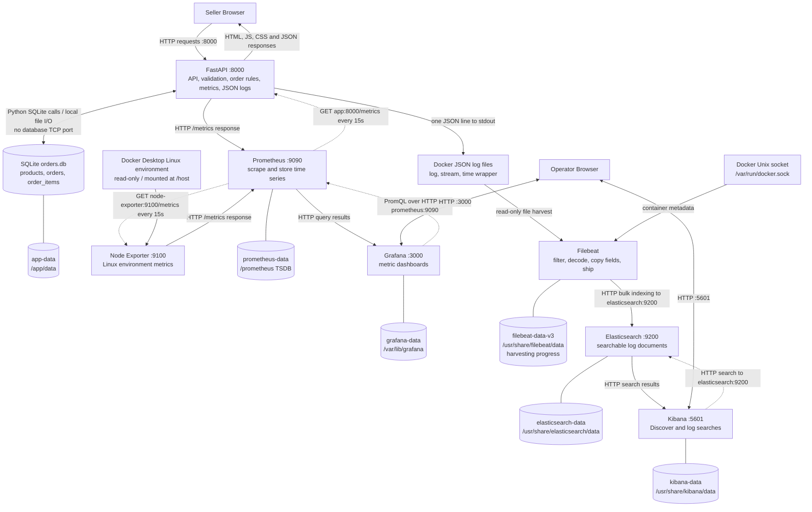

# Part D: System Design — Milestone 8

This describes the existing implementation. It adds no application features or pipeline versions. Configuration is taken from [Docker Compose](../docker-compose.yml), [Prometheus](../prometheus.yml), [Filebeat](../filebeat/filebeat.yml), and the provisioned Grafana dashboard. Observations are saved with this document; configured behavior is distinguished from visually verified behavior.

## Architecture

Solid arrows below show the direction in which data travels. Dotted arrows show requests that pull that data. A scrape is an HTTP request made by Prometheus; FastAPI and Node Exporter do not push metrics to it.



Compose services communicate by service name on the Compose network. Host ports are 8000, 9090, 3000, 9200 and 5601. Node Exporter exposes 9100 inside that network; Compose does not publish it on the host. SQLite and Filebeat have no application-facing listening port here. This is a local HTTP deployment; Elasticsearch security is disabled in the supplied configuration.

## Components, in plain language

| Component | What it does | Who communicates with it | What it stores | Why this choice fits this project | If it stops working |
|---|---|---|---|---|---|
| Seller Browser | Displays inventory and submits order and stock actions. | Sends HTTP requests to FastAPI and receives pages and JSON. | Temporary page state; it is not the authoritative order store. | A browser needs no separate seller desktop installation. | That seller cannot operate the interface; existing server data remains. |
| FastAPI | Validates requests, calls business rules, returns responses, and exposes metrics and logs. | Seller Browser, local SQLite library, Prometheus, and Docker stdout capture. | Business data goes to SQLite; metric counters and request context live in process memory. | Python routes and request validation keep this small API understandable. | Order operations and application scrapes fail. Existing SQLite data survives in its volume; process counters reset on restart. |
| SQLite | Stores products, orders and order items with transactions. | Only application code opens its database file. | `/app/data/orders.db` in `app-data`. | An embedded database avoids another server for a small, single application deployment. | If the file cannot be accessed or a transaction fails, affected operations fail. SQLite is a library/file, not a separate service to restart. |
| Docker / Compose | Runs the components, provides service networking and captures stdout/stderr. | All containers; Filebeat reads Docker logs and metadata. | Container log files in Docker-managed storage; named volumes outlive container recreation. | One configuration makes the multi-service setup repeatable. | If the Docker engine stops, the entire container stack becomes unavailable. Persistent volumes normally remain. |
| Prometheus | Polls metric endpoints and saves numbered samples with labels and times. | Pulls from FastAPI and Node Exporter; answers Grafana queries. | Time series in `prometheus-data` at `/prometheus`. | Its pull model and PromQL suit counters, gauges and rates. | New samples are missed and Grafana queries fail. Orders can continue. Missing scrape history is not automatically reconstructed later. |
| Node Exporter | Exposes CPU, memory, filesystem and network measurements. | Prometheus scrapes port 9100; exporter reads the visible Linux environment. | No historical metrics database. `/host` is a read-only host mount. | It supplies standard infrastructure measurements without adding them to business code. | Infrastructure samples stop; application metrics and order processing can continue. |
| Grafana | Turns metric query results into panels. | Operator Browser accesses 3000; Grafana queries Prometheus at 9090. | Local settings/database in `grafana-data`; dashboard and datasource definitions are also provisioned from repository files. | It makes Prometheus measurements easier to compare and explain. | Dashboards are unavailable, but Prometheus can keep collecting and storing samples. |
| Filebeat | Reads Docker logs, keeps the app container's events, extracts fields and sends documents. | Reads container files and Docker socket; writes to Elasticsearch. | Harvesting progress/registry in `filebeat-data-v3`; this is not the searchable log archive. | It provides Docker metadata and restart-aware log harvesting. | Shipping pauses. Retained Docker logs may be read after recovery; logs removed before harvesting cannot be recovered from the registry. |
| Elasticsearch | Indexes structured log documents so fields and message text can be searched. | Filebeat writes; Kibana and diagnostic HTTP clients query port 9200. | Log indexes and Kibana saved objects in `elasticsearch-data`. | It supports both exact structured-field filters and text search. | Log indexing/search fails. Filebeat can retry temporary outages, but permanent mapping errors can cause documents to be dropped, as observed in Milestone 7. |
| Kibana | Provides Discover and data views for Elasticsearch logs. | Operator Browser accesses 5601; Kibana queries Elasticsearch at 9200. | Saved data views/dashboards are primarily Elasticsearch saved objects. The configured `kibana-data` mount preserves Kibana local runtime data. | It provides a direct interface to inspect and correlate indexed JSON events. | The log UI is unavailable; Filebeat can still index and Elasticsearch can still answer direct queries. |

Node Exporter runs inside Docker Desktop's Linux environment. Its measurements do not establish total native Windows usage or FastAPI-only resource consumption. SQLite remains the business source of truth; neither metrics nor logs replace order records.

## Storage and persistence

| Named volume | Mounted at | Purpose |
|---|---|---|
| `app-data` | `/app/data` | SQLite database |
| `prometheus-data` | `/prometheus` | Prometheus time-series database |
| `grafana-data` | `/var/lib/grafana` | Grafana settings and local database |
| `elasticsearch-data` | `/usr/share/elasticsearch/data` | Indexed logs and saved objects |
| `filebeat-data-v3` | `/usr/share/filebeat/data` | Filebeat registry and harvesting state |
| `kibana-data` | `/usr/share/kibana/data` | Kibana local data |

Compose also declares `filebeat-data` and `filebeat-data-v2`, but the current service mounts only `filebeat-data-v3`. Declaring a volume does not mean a current component uses it. Compose may prefix actual Docker volume names with the project name.

Read-only bind mounts supply Prometheus configuration, Grafana provisioning/dashboard files, Filebeat configuration, Docker container logs and the Docker socket. Node Exporter mounts `/` as `/host:ro`. Docker log files are separate from `app-data` and Filebeat's registry volume. Normal container recreation preserves named volumes; deleting volumes loses the data in them. A persistent volume is not a backup or a second replica.

## Follow one actual metric: `orders_created_total`

### 1. Code and update

[app/metrics.py, line 14](../app/metrics.py) defines:

```python
ORDERS_CREATED = Counter("orders_created_total", "Total orders created.")
```

The `POST /api/orders` handler in [app/main.py, lines 162–170](../app/main.py) calls `store.create_order(...)`, then runs `ORDERS_CREATED.inc()` in add_order. The successful business transaction commits in [app/services.py](../app/services.py) before control returns to the route. Each execution of that increment adds one to the process-local counter. A rejected business-rule attempt increments `ORDERS_REJECTED` instead.

The saved real order event is order `20`, request `pipeline-proof-20260922171843`. That route logs the event after the increment. No counter sample immediately before/after that individual request was saved, so this document does not claim a measured transition for that order.

### 2. Exposition at `/metrics`

[app/main.py, lines 194–196](../app/main.py) returns `generate_latest()` using `CONTENT_TYPE_LATEST`. This converts the in-memory metric into Prometheus text. A read-only observation during this documentation task returned:

```text
# HELP orders_created_total Total orders created.
# TYPE orders_created_total counter
orders_created_total 5.0
```

The [saved endpoint response](part-d-evidence/metrics.txt) contains this sample. The value `5` is the running process's counter, not the database order ID `20` and not necessarily the number of orders ever stored. Restarting the application resets this counter.

### 3. Scrape and storage

[prometheus.yml](../prometheus.yml) configures job `fastapi-app`, target `app:8000`, interval `15s`; the default metrics path is `/metrics`. Prometheus requests the text and attaches `job="fastapi-app"` and `instance="app:8000"` labels. Samples and timestamps are stored in its TSDB at `/prometheus`, backed by `prometheus-data`.

The [saved targets response](part-d-evidence/prometheus-targets.json) records scrape status. A successful scrape can happen up to roughly one configured interval after an application update; collection and dashboard refresh are separate steps.

### 4. Actual PromQL result

The HTTP request `GET http://localhost:9090/api/v1/query?query=orders_created_total` returned this [saved result](part-d-evidence/prometheus-orders-created.json):

```json
{"status":"success","data":{"resultType":"vector","result":[{"metric":{"__name__":"orders_created_total","instance":"app:8000","job":"fastapi-app"},"value":[1790080660.931,"5"]}]}}
```

The numeric timestamp is the query evaluation time in Unix seconds. This instant-query response proves Prometheus returned `5`; it does not by itself give the exact timestamp of the most recent underlying scrape.

### 5. Grafana panel

[grafana/dashboards/observable-orders.json, lines 11–20](../grafana/dashboards/observable-orders.json) defines panel ID `1`, title **Orders created**, type **Stat**, datasource UID `prometheus`, query:

```promql
orders_created_total
```

Its reducer is `lastNotNull`. The [datasource configuration](../grafana/provisioning/datasources/prometheus.yml) uses proxy access to `http://prometheus:9090`. Grafana requests the series, then reduces it to the last non-null value for display. The observed Prometheus result supports a value of `5` at that observation; no new rendered-panel screenshot was captured here, so visual display is not claimed as newly verified.

For comparison, the existing **Order creation rate** panel uses `rate(orders_created_total[$__rate_interval])`. That asks how quickly orders are being accepted, in orders per second. It is a different question from the total; no unobserved rate value is supplied here.

## Follow one actual log: order `20`

This journey uses saved Milestone 7 evidence, not a fabricated example or a new business transaction.

### 1. Application event becomes JSON

After accepting the order, [app/main.py: add_order](../app/main.py) calls:

```python
log_event(20, "order created", order_id=order.id)
```

Python logging level `20` means INFO. [app/logging_config.py](../app/logging_config.py) gets the request ID from a request-local `ContextVar`, adds a UTC timestamp and service name, serializes JSON, and writes one line to stdout. The actual line was:

```json
{"message":"order created","order_id":20,"request_id":"pipeline-proof-20260922171843","service":{"name":"instagram-order-desk"},"severity":"INFO","timestamp":"2026-09-22T12:18:43.875352+00:00"}
```

### 2. Docker wraps the line

Docker records the line as a string inside another JSON object. From the [actual Docker evidence](../diagnostics/milestone7/docker-raw-proof.log):

```json
{"log":"{\"message\":\"order created\",\"order_id\":20,\"request_id\":\"pipeline-proof-20260922171843\",\"service\":{\"name\":\"instagram-order-desk\"},\"severity\":\"INFO\",\"timestamp\":\"2026-09-22T12:18:43.875352+00:00\"}\n","stream":"stdout","time":"2026-09-22T12:18:43.87593895Z"}
```

The backslashes escape quotation marks inside the `log` string. The application timestamp and Docker capture time are separate observations.

### 3. Filebeat unwraps, filters and decodes

The following intermediate description follows [filebeat/filebeat.yml](../filebeat/filebeat.yml); it is a configuration-derived explanation, not a separately captured snapshot between each processor.

1. The `container` parser reads the Docker wrapper. The inner `log` string becomes `message`; Docker time supplies `@timestamp`; `stream` is retained.
2. `add_docker_metadata` attaches a `container` object, including `container.name`.
3. `drop_event` discards containers whose name is not `observable-orders-app`. This is an app-container filter: it also admits that container's Uvicorn access logs, not only structured business logs.
4. `decode_json_fields` parses `message` into temporary `json`. At this point `json.order_id` is numeric, `json.service` is an object, and request ID, severity, message and application timestamp are strings.
5. `copy_fields` copies `json.service.name`, `json.severity`, `json.request_id` and `json.order_id` to searchable fields outside `json`.
6. `copy_fields` also attempts `json.message` → `message`, but the destination already exists. The actual indexed evidence shows it retains the original JSON string. Do not describe this as a clean message replacement.
7. `drop_fields` removes `json`; `add_fields` adds `pipeline: observable-orders-docker`. The application `timestamp` is not separately copied; it remains inside the retained message string. `@timestamp` remains searchable.

### 4. Elasticsearch stores the actual document

Filebeat sends HTTP bulk requests to `http://elasticsearch:9200`. Its target is `observable-orders-v3-%{+yyyy.MM.dd}`. The observed document's backing index is `.ds-observable-orders-v3-2026.09.22-2026.09.22-000001`: this deployment uses a data stream backing index even though Filebeat's ILM setting is disabled.

Relevant fields from the [complete returned document](../diagnostics/milestone7/actual-document.json), with unrelated metadata omitted:

```json
{
  "service": {"name": "instagram-order-desk"},
  "severity": "INFO",
  "request_id": "pipeline-proof-20260922171843",
  "order_id": 20,
  "message": "{\"message\":\"order created\",\"order_id\":20,\"request_id\":\"pipeline-proof-20260922171843\",\"service\":{\"name\":\"instagram-order-desk\"},\"severity\":\"INFO\",\"timestamp\":\"2026-09-22T12:18:43.875352+00:00\"}\n",
  "@timestamp": "2026-09-22T12:18:43.875Z",
  "container": {"name": "observable-orders-app"}
}
```

| Field | Stored structure/type | Meaning |
|---|---|---|
| `message` | String, mapped `match_only_text` | Original JSON text; searchable as text |
| `service` | Object; `service.name` is keyword | Identifies the application |
| `severity` | Keyword | Exact INFO/WARNING filters |
| `request_id` | Keyword | Correlates events for one request; use this field directly, not `request_id.keyword` |
| `order_id` | Long integer | Correlates an accepted order |
| `@timestamp` | Date | Docker event time used for time filtering |
| `timestamp` | Absent as a separate top-level field | Application time survives inside `message` |
| `container` | Object; `container.name` is keyword | Identifies the source container |
| `json` | Absent after processing | Temporary decoded object was removed |

The [historical exact 400](../diagnostics/milestone7/exact-400.txt) explains why structure matters: Elasticsearch rejected a scalar `service` because its mapping expected an object. The current object-shaped service matches that mapping. Successful HTTP responses from the application alone would not have proved successful log indexing.

### 5. Kibana query and evidence boundary

The saved [Kibana data view](../diagnostics/milestone7/kibana-data-view.json) is `observable-orders-v3-*` (ID `observable-orders-v3`). In Discover, select **Observable Orders Logs**, choose a time range containing **2026-09-22 12:18:43 UTC / 17:18:43 Asia/Karachi**, and enter:

```kql
request_id : "pipeline-proof-20260922171843"
```

Additional useful KQL:

```kql
order_id : 20
```

```kql
request_id : "pipeline-proof-20260922171843" and severity : "INFO"
```

```kql
request_id : "pipeline-proof-20260922171843-rejected" and message : "order rejected"
```

Saved Elasticsearch searches returned **2** proof-request documents, **1** order-ID document, **2** INFO documents for the proof request, and **1** matching rejected-order message. A request can create both a business-event log and a request-completion log. The rejected attempt had insufficient stock and no newly created order ID.

Kibana health and data-view existence were verified previously. Discover rendering of the proof event remains **NOT VERIFIED** because no browser was available in that verification session. A valid data view is configuration evidence, not proof that a user saw the document.

## MILESTONE 8 VERIFICATION

The Part D documentation is complete. Live `/metrics` and Prometheus values were read without creating orders. The Grafana panel definition and saved log journey were inspected. This documentation does not upgrade the outstanding Kibana Discover verification to a pass.

- [ ] Explain solid data-flow arrows versus dotted pull-request arrows in the diagram.
- [ ] Locate the counter definition, increment and `/metrics` route in source code.
- [ ] Compare the saved `5.0` exposition with the Prometheus result `"5"`; explain why neither means order ID 5.
- [ ] Open Grafana's **Orders created** panel and inspect its `orders_created_total` query. Its current value may have changed since the saved observation.
- [ ] Open Kibana Discover with the exact request ID and historical time range above; confirm the actual order `20` event before marking UI verification complete.
- [ ] Explain which data survives container recreation and why deleting volumes is different.

### Questions an instructor might ask

| Question | Short answer to understand |
|---|---|
| What happens when a seller creates an order? | The browser posts JSON to FastAPI. Business rules check stock and commit the order in SQLite. The route increments a counter and emits a JSON log, then returns the result. |
| Does FastAPI send metrics to Grafana? | No. Prometheus requests `/metrics`; Grafana queries Prometheus. Metrics travel toward Grafana, while scrape/query requests travel the other way. |
| Why do we need SQLite and Prometheus? | SQLite stores individual business records. Prometheus stores measurements over time. A counter cannot reconstruct an order's items. |
| Why is the counter 5 while the example order ID is 20? | The counter belongs to a running process and resets on restart. SQLite order IDs persist independently. We did not measure the counter immediately around that particular order. |
| Is a counter the same as a rate? | A counter is a cumulative value. `rate` estimates its average increase per second over a window and handles resets. |
| Why does an update not appear instantly in Grafana? | Prometheus scrapes every 15 seconds, and Grafana refreshes separately. Query windows also affect what is shown. |
| What is Node Exporter measuring on this computer? | The Linux environment visible to its Docker Desktop container, not an assertion about all native Windows processes or only FastAPI. |
| Why use both metrics and logs? | Metrics show quantities and trends. Logs explain particular events and let us correlate a request or order. |
| Why is Docker's log JSON different from the application JSON? | Docker wraps the application line as a string with stream and capture time. Filebeat first unwraps it, then decodes the application's JSON. |
| What did the Elasticsearch 400 mean? | The event supplied `service` as a string, while the index expected an object. The current `service.name` object structure satisfies that mapping. |
| Does Filebeat keep only business-event JSON? | No. Its filter keeps the app container, including its Uvicorn logs. Non-JSON lines can carry JSON-decoding errors. |
| Why does `message` still look like JSON? | The current copy step does not replace the existing message field. Other useful fields are separately extracted; we document the observed shape. |
| Why put request IDs in logs rather than metric labels? | Every new request ID would create another metric series. Logs support that detailed per-request correlation without multiplying metric series. |
| What happens when Elasticsearch is down? | Orders can continue, but log search and indexing are disrupted. Filebeat can retry temporary failures; retained source logs and buffering limit recovery. |
| What happens when Grafana is down? | We lose the dashboard interface. Prometheus can still collect and store metrics. |
| Does a volume guarantee no data loss? | No. It survives normal container replacement but can be deleted or damaged. This design has no demonstrated backup or multi-node failover. |
| Does a green Kibana health check prove the event is visible? | No. We must search the correct data view and time range and actually see the document. That UI check remains outstanding. |
| Could the order succeed even if its log is lost? | Yes. SQLite commits the order separately from asynchronous log shipping. Observability failures do not undo that transaction. |
